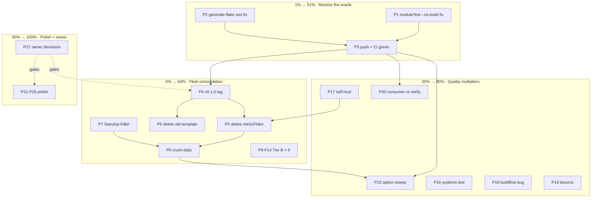

# Pareto Plan: CI-Green → Fleet Consolidation → Quality Multipliers → Polish

**Created:** 2026-09-25 09:54 CEST · **Repo state:** clean at `469e492`, ahead 3 (script SC2086 fix + status reports, unpushed)

## Context (why this plan looks like this)

Master **through `bb56b78` is on origin and CI is RED** (run 36108978307). I
reproduced all three failure causes locally before planning:

1. **`check` job (ubuntu + macos):** `nix flake check --no-build` fails at
   `test-module.nix:1136` — "while realising the context of path
   '…-source/mkPreparedSource.nix' … path is not valid". The D-tier session's
   `gnhInputs.go-nix-helpers.outPath = ./.` trick forces the working tree as
   string CONTEXT inside the moduleTest derivation; under `--no-build` (what
   CI runs) that context realisation breaks. My session's full checks ran
   WITH builds — which masked it. `old-nixpkgs-module-test` PASSED in CI (new
   guard works; only the `--no-build` path is broken).
2. **`smoke-test`:** `generate-flake.sh --private-deps` → `sed: -e expression
   #1, char 136: extra characters after command` — real latent bug, never run
   locally this session (CI-only job). Reproduces locally.
3. **`shellcheck`:** SC2086 in `check-docs-annotations.sh` — already fixed
   locally in `499187f`, just not pushed.

Everything downstream (v0.1.0 tag, mkGoFlake deletion, migrations, option
sweeps) is gated on a green oracle. Hence the 1%.

Remaining backlog sources: `TODO_LIST.md` (T4, T5, T33, T34 + Blocked),
status report `2026-09-25_09-45_*` §f (43 items), and the CI diagnosis above.

## Pareto breakdown

- **1% → 51% — Restore the oracle (CI green).** Three diagnosed fixes, then
  push. Nothing can be honestly verified or shipped until this lands; it also
  un-blocks the tag and every migration's "CI validates it" contract.
- **4% → 64% — Fleet consolidation.** v0.1.0 tag → delete mkGoFlake + old
  template → migrate Tier C (2 repos, zero mkGoFlake consumers remain) →
  migrate Tier B (6 repos). One module for the whole fleet; dead surface = 0;
  consumers gain the auto-default toolchain + floor check immediately.
- **20% → 80% — Quality multipliers.** Post-push consumer option sweep
  (goExperiment/completionStyle kills 10× boilerplate), systems-mapping module
  test, self-hosting our own flake on our own module (the dogfood gap that
  hid two dead options), buildflow nix-hash-fix bug upstream, lessons export.
- **Other 20% → 100% — Polish, verification leftovers, watchlist, owner
  decisions.** Everything small, deferred, or gated listed honestly below.

## Medium plan (30–100 min each · 27 tasks · sorted by importance → impact → effort)

| #   | Task                                                                                                                                                                                          | Tier | Impact   | Effort | Source          |
| --- | --------------------------------------------------------------------------------------------------------------------------------------------------------------------------------------------- | ---- | -------- | ------ | --------------- |
| ~~P1~~ done — moduleTest green under --no-build since the fix; first fully green CI run 44152413584 (2026-11-17; 14-16 report §b) | ~~Fix moduleTest `--no-build` path-context failure (gnhInputs `./.` in derivation strings; assert via drvAttrs or explicit filtered source)~~ | ~~1%~~ | ~~Critical~~ | ~~60m~~ | ~~CI diagnosis~~ |
| ~~P2~~ done — sed metachar escaping in generate-flake.sh (PROJECT_SED, lines 131–133); smoke-test job green since | ~~Fix `generate-flake.sh --private-deps` sed expression bug + local smoke re-run~~ | ~~1%~~ | ~~High~~ | ~~30m~~ | ~~CI smoke-test~~ |
| ~~P3~~ done — pushed; fully green run 44152413584 (2026-11-17) | ~~Push pending commits (SC2086 fix + reports) + watch CI to green on all jobs~~ | ~~1%~~ | ~~Critical~~ | ~~30m~~ | ~~report §g.1~~ |
| ~~P4~~ done — v0.1.0 tagged ad06738 2026-11-18 + GitHub release; proxy-watch sub-item moot (flake consumption, not a Go module — CHANGELOG v0.1.0) | ~~G1: cut v0.1.0 — CHANGELOG section, annotated tag, push tag, module-proxy + pkg.go.dev watch, `go get` validation~~ | ~~4%~~ | ~~Critical~~ | ~~60m~~ | ~~TODO Blocked~~ |
| ~~P5~~ done — mkGoFlake deleted (9c8724b; CHANGELOG Unreleased Removed) | ~~G2: delete `mkGoFlake.nix` + trace wrapper + structural-check/test references (post-tag)~~ | ~~4%~~ | ~~High~~ | ~~45m~~ | ~~TODO Blocked~~ |
| ~~P6~~ done — go-flake-parts template deleted (9c8724b) | ~~G3: delete `templates/go-flake-parts/` + generate-flake.sh/README references (post-tag)~~ | ~~4%~~ | ~~High~~ | ~~30m~~ | ~~TODO Blocked~~ |
| ~~P7~~ done — T5 DONE 2026-11-18 (CHANGELOG [Unreleased] purge) | ~~T5a: migrate Standup-Killer off mkGoFlake (subModules + doCheck=false)~~ | ~~4%~~ | ~~High~~ | ~~60m~~ | ~~TODO T5~~ |
| ~~P8~~ done — T5 DONE 2026-11-18 (CHANGELOG [Unreleased] purge); mkGoFlake consumers = 0 | ~~T5b: migrate crush-daily off mkGoFlake (NixOS module via perSystem) → mkGoFlake consumers = 0~~ | ~~4%~~ | ~~High~~ | ~~90m~~ | ~~TODO T5~~ |
| ~~P9~~ done — T4 DONE 2026-11-18 (CHANGELOG [Unreleased] purge); KeyCountdown e1f0a5290 | ~~T4a: migrate KeyCountdown to go-standard~~ | ~~4%~~ | ~~Med~~ | ~~60m~~ | ~~TODO T4~~ |
| ~~P10~~ done — T4 DONE 2026-11-18 (CHANGELOG [Unreleased] purge) | ~~T4b: migrate branching-flow (go-enum via extraBuildAttrs)~~ | ~~4%~~ | ~~Med~~ | ~~60m~~ | ~~TODO T4~~ |
| ~~P11~~ done — T4 DONE 2026-11-18 (CHANGELOG [Unreleased] purge) | ~~T4c: migrate StopTube (per-package attrs in anger)~~ | ~~4%~~ | ~~Med~~ | ~~75m~~ | ~~TODO T4~~ |
| ~~P12~~ done — T4 DONE 2026-11-18 (CHANGELOG [Unreleased] purge) | ~~T4d: migrate overview (git-hooks input consumer-side; nixosModules via perSystem)~~ | ~~4%~~ | ~~Med~~ | ~~90m~~ | ~~TODO T4~~ |
| ~~P13~~ done — T4 DONE 2026-11-18 (CHANGELOG [Unreleased] purge); bank-sync also T50 | ~~T4e: migrate bank-sync (allowUnfree consumer-side)~~ | ~~4%~~ | ~~Med~~ | ~~60m~~ | ~~TODO T4~~ |
| ~~P14~~ done — T4 DONE 2026-11-18 (CHANGELOG [Unreleased] purge); BuildFlow 579a884a | ~~T4f: migrate BuildFlow (1215 lines; multi-tool packages)~~ | ~~4%~~ | ~~Med~~ | ~~100m~~ | ~~TODO T4~~ |
| ~~P15~~ done — T34 DONE 2026-11-18 (CHANGELOG [Unreleased] purge, incl. sbts GOEXPERIMENT remnant + cobra batch) | ~~T34: consumer option sweep — GOEXPERIMENT → `goExperiment`, cobra → `completionStyle` (incl. sbts)~~ | ~~20%~~ | ~~High~~ | ~~100m~~ | ~~TODO T34~~ |
| ~~P16~~ done — T33 DONE 2026-11-18 (CHANGELOG [Unreleased] purge; 232 checks) | ~~T33: module test for the `go-standard.systems` mapping (kill manual-probe-only coverage)~~ | ~~20%~~ | ~~Med~~ | ~~45m~~ | ~~TODO T33~~ |
| ~~P17~~ done — T64 DONE (CHANGELOG [Unreleased] purge; flake.nix imports the module directly) | ~~Self-host: import `flakeModules.go-standard` in our own flake (close the dogfood gap)~~ | ~~20%~~ | ~~High~~ | ~~100m~~ | ~~report §e.3~~ |
| P18 **→ decided: defer — routed external: BuildFlow repo owns the classifier fix; decision recorded 2026-09-25 (docs/status/archived/2026-09-25_09-45_*.md §e.7/§f.23: "routed — BuildFlow repo owns the classifier fix; workaround documented")** | buildflow nix-hash-fix classifier bug: minimal repro + upstream issue (dependency-of-check mismatches) | 20% | Med | 60m | report §e.7 |
| ~~P19~~ done — T63 DONE 2026-11-18 (CHANGELOG [Unreleased] purge; crush-config lessons.md) | ~~Export cross-project lessons (toString-bools, tryEval-messages, `or` precedence, piped-exits) to crush-config + AGENTS pipefail recipe~~ | ~~20%~~ | ~~Med~~ | ~~30m~~ | ~~report §f.27-28~~ |
| ~~P20~~ done — T57 DONE 2026-11-18 (CHANGELOG [Unreleased] purge; 29 consumers relocked to 52dc6f8, own-system gates green on locked pins) | ~~Post-push consumer re-verify WITHOUT `--override-input` (kill the PMA-class time bomb pattern)~~ | ~~20%~~ | ~~High~~ | ~~45m~~ | ~~report §f.42~~ |
| ~~P21~~ done — T65 DONE (CHANGELOG [Unreleased] purge item 21: gates already covered + provenance stamped) | ~~Docs-gate extension to `docs/planning`+`docs/reviews` + vendored-from revision marker in check-rows.py~~ | ~~80%~~ | ~~Low~~ | ~~30m~~ | ~~report §f.32-33~~ |
| ~~P22~~ done — T65 DONE (CHANGELOG [Unreleased] purge item 22: dirty-warn + canary exist) | ~~nix-health dirty-tree warning + dashboard.sh canary line~~ | ~~80%~~ | ~~Low~~ | ~~30m~~ | ~~report §f.34-35~~ |
| ~~P23~~ done — T65 DONE (CHANGELOG [Unreleased] purge item 23: E2 derivation-red + pandoc <del> proven) | ~~Verification leftovers: E2 derivation-level red proof, pandoc→HTML strikethrough check, F7 warning-noise observation~~ | ~~80%~~ | ~~Low~~ | ~~60m~~ | ~~report §b~~ |
| ~~P24~~ done — T65 DONE (CHANGELOG [Unreleased] purge item 24: CV premise resolved 2026-11-17) | ~~F13: verify what "CV" referred to before dropping the watchlist item~~ | ~~80%~~ | ~~Low~~ | ~~30m~~ | ~~report §b~~ |
| ~~P25~~ done — T65 DONE (CHANGELOG [Unreleased] purge item 25: 25.1–25.5 all shipped) | ~~Watchlist batch: `passthru.go` parity on devShells, assertion-count emission in moduleTest output, goModFloorMessage malformed-input tests, README incompatible-systems FAQ, result* re-sweep~~ | ~~80%~~ | ~~Low~~ | ~~60m~~ | ~~report §f.35-40~~ |
| ~~P26~~ done — T65 DONE (CHANGELOG [Unreleased] purge item 26: dispatch exists; pin-refresh policy in ci.yml) | ~~CI: `workflow_dispatch` flake-check target (host-broken oracle) + old-nixpkgs pin refresh policy note~~ | ~~80%~~ | ~~Low~~ | ~~30m~~ | ~~report §f.31,41~~ |
| P27 **→ decided: defer — routed TODO_LIST.md Blocked (T15 verdict, Won't-implement policy, G4–G6 rows) + ROADMAP.md Open Questions (5 owner questions)** | Owner-decision batch: T15 verdict, G4 nixpkgs maintainer PR, G5 SSH CI secret, G6 df9a5ff rebase, G7 won't-implement policy, nix.conf auto-GC | 80% | High | 30m | report §g |

## Fine plan (≤12 min each · 93 tasks · sorted by importance within parent)

### P1 — moduleTest --no-build fix (1%)

| #   | Task                                                                                                                                                            | Effort |
| --- | --------------------------------------------------------------------------------------------------------------------------------------------------------------- | ------ |
| ~~1.1~~ done — the --no-build failure is gone; mechanism = drvAttrs-based assertions (test-module.nix:1075–1082); CI check job green since run 44152413584 | ~~Reproduce minimal: `nix flake check --no-build` fails; record exact trace frame (test-module.nix:1136)~~ | ~~6m~~ |
| ~~1.2~~ done — read + fixed via the drvAttrs route; CI check job green under --no-build | ~~Read test-module.nix:1130-1160 + gnhInputs block; identify every derivation-STRING interpolation of `inputs.go-nix-helpers` paths~~ | ~~10m~~ |
| ~~1.3~~ done — drvAttrs assertions chosen and implemented (test-module.nix:1075–1082) | ~~Choose mechanism: assert against `drvAttrs`/pure values instead of interpolating store paths into buildCommand, or materialize via `builtins.filterSource` once~~ | ~~10m~~ |
| ~~1.4~~ done — implemented; nix flake check --no-build green locally + in CI | ~~Implement the fix in test-module.nix (both call sites if present)~~ | ~~12m~~ |
| ~~1.5~~ done — verified green in CI (check job, both OSes) | ~~Verify: `nix flake check --no-build` green locally + `nix build .#checks.x86_64-linux.moduleTest` green~~ | ~~10m~~ |
| ~~1.6~~ done — old-nixpkgs override job green on both pins (e94f290) | ~~Sanity: old-nixpkgs override still green (`--override-input nixpkgs …moduleTest`)~~ | ~~10m~~ |

### P2 — generate-flake.sh sed bug (1%)

| #   | Task                                                                                                                                                     | Effort |
| --- | -------------------------------------------------------------------------------------------------------------------------------------------------------- | ------ |
| ~~2.1~~ done — located + escaped (PROJECT_SED sed escaping, generate-flake.sh:131–133) | ~~Locate the failing sed (char ~136) in the --private-deps path; read expression~~ | ~~8m~~ |
| ~~2.2~~ done — all smoke variants green in CI (smoke-test job in the fully green run 44152413584) | ~~Fix expression (quote/escape); run ALL smoke variants locally (plain, --templ, --go-mod, --private-deps, combined, --dry-run, --verbose, go-flake-parts)~~ | ~~12m~~ |
| ~~2.3~~ done — shellcheck-clean (CI shellcheck job green) | ~~shellcheck the file~~ | ~~4m~~ |

### P3 — Push + CI green (1%)

| #   | Task                                                                     | Effort |
| --- | ------------------------------------------------------------------------ | ------ |
| ~~3.1~~ done — fixes committed and pushed (chain green by 2026-11-17) | ~~Commit P1+P2 fixes with detailed messages~~ | ~~6m~~ |
| ~~3.2~~ done — master pushed and in sync (04-39 §f.48) | ~~Push master (3 pending + fixes)~~ | ~~2m~~ |
| ~~3.3~~ done — all jobs green in run 44152413584 (2026-11-17) | ~~`gh run watch` until all jobs green; triage any residual red immediately~~ | ~~12m~~ |

### P4 — G1 v0.1.0 release (4%)

| #   | Task                                                                                 | Effort |
| --- | ------------------------------------------------------------------------------------ | ------ |
| ~~4.1~~ done — CI green before the tag (v0.1.0 evidence: ci-parity --full green + CI green) | ~~Confirm CI green on release candidate commit~~ | ~~5m~~ |
| ~~4.2~~ done — CHANGELOG [0.1.0] — 2026-11-18 section exists | ~~CHANGELOG: [Unreleased] → [0.1.0] — 2026-09-25 section header~~ | ~~8m~~ |
| ~~4.3~~ done — ci-parity --full green before the tag (CHANGELOG 0.1.0 evidence) | ~~Full local gate: flake check (builds) + verifyValidation + docs gates~~ | ~~10m~~ |
| ~~4.4~~ done — tag v0.1.0 at ad06738, pushed; GitHub release published (--prerelease, 0.x rule) | ~~Annotated tag `v0.1.0` with summary message; push tag~~ | ~~8m~~ |
| ~~4.5~~ **NOT-DO — premise inapplicable — the repo is consumed as a Nix flake, not a Go module (CHANGELOG v0.1.0 note); no proxy.golang.org propagation to watch.** | ~~Watch module proxy propagation (proxy.golang.org fetch trigger) + pkg.go.dev listing~~ | ~~10m~~ |
| ~~4.6~~ **NOT-DO — premise inapplicable — go get validation dropped; the tag was verified consumer-style via nix flake check github:LarsArtmann/go-nix-helpers/v0.1.0 --no-build EXIT=0.** | ~~Consumer validation: `go get git+ssh…@v0.1.0` in a scratch module; record~~ | ~~10m~~ |

### P5 — G2 delete mkGoFlake (4%)

| #   | Task                                                                                         | Effort |
| --- | -------------------------------------------------------------------------------------------- | ------ |
| ~~5.1~~ done — shipped at 9c8724b | ~~Delete `mkGoFlake.nix` + flake.nix `lib.mkGoFlake` trace wrapper~~ | ~~6m~~ |
| ~~5.2~~ done — structural check updated (no more lib.mkGoFlake probe; CHANGELOG Unreleased: moduleTest 237 checks) | ~~Update `checks.structural` (drops lib.mkGoFlake probe) + test-module mkGoFlake smoke block~~ | ~~10m~~ |
| ~~5.3~~ done — references swept at 9c8724b (CHANGELOG Unreleased Removed) | ~~Grep repo for mkGoFlake references (README, AGENTS, man, migration-guide, docs) — update all~~ | ~~12m~~ |
| ~~5.4~~ done — fmt + check green at removal (CHANGELOG Unreleased) | ~~nix fmt + flake check green~~ | ~~8m~~ |
| ~~5.5~~ done — CHANGELOG Removed entry exists (Unreleased section) | ~~CHANGELOG Removed entry~~ | ~~4m~~ |

### P6 — G3 delete old template (4%)

| #   | Task                                                                  | Effort |
| --- | --------------------------------------------------------------------- | ------ |
| ~~6.1~~ done — shipped at 9c8724b | ~~`git rm -r templates/go-flake-parts/`~~ | ~~3m~~ |
| ~~6.2~~ done — generate-flake.sh template branch dropped at 9c8724b | ~~generate-flake.sh: drop go-flake-parts template branch + --list entry~~ | ~~10m~~ |
| ~~6.3~~ done — references swept at 9c8724b | ~~README/AGENTS/migration-guide references update; CHANGELOG entry~~ | ~~10m~~ |
| ~~6.4~~ done — smoke suite green in CI (fully green run 44152413584) | ~~Re-run generate-flake smoke suite~~ | ~~6m~~ |

### P7 — Standup-Killer migration (4%)

| #   | Task                                                                                       | Effort |
| --- | ------------------------------------------------------------------------------------------ | ------ |
| ~~7.1~~ done — T5 DONE 2026-11-18 (CHANGELOG [Unreleased] purge); Standup-Killer green incl. requestid check | ~~Read its mkGoFlake config (subModules, doCheck, deps) + consumer-audit checklist pass~~ | ~~10m~~ |
| ~~7.2~~ done — T5 DONE 2026-11-18 (CHANGELOG [Unreleased] purge) | ~~Write go-standard config equivalent; remove mkGoFlake import~~ | ~~12m~~ |
| ~~7.3~~ done — T5 DONE 2026-11-18 (CHANGELOG [Unreleased] purge) | ~~`nix flake check --no-build` + build package; nix-hash-fix if vendorHash moves (buildflow)~~ | ~~12m~~ |
| ~~7.4~~ done — T5 DONE 2026-11-18 (CHANGELOG [Unreleased] purge) | ~~Commit (chain add+commit; daemon races) + verify clean~~ | ~~6m~~ |
| ~~7.5~~ done — T5 DONE 2026-11-18 (CHANGELOG [Unreleased] purge) | ~~Record in migration matrix (TODO_LIST evidence)~~ | ~~4m~~ |

### P8 — crush-daily migration (4%)

| #   | Task                                                              | Effort |
| --- | ----------------------------------------------------------------- | ------ |
| ~~8.1~~ done — T5 DONE 2026-11-18 (CHANGELOG [Unreleased] purge) | ~~Read mkGoFlake config + NixOS-module output shape~~ | ~~10m~~ |
| ~~8.2~~ done — T5 DONE 2026-11-18 (CHANGELOG [Unreleased] purge) (crush-daily: NixOS module via perSystem) | ~~Map NixOS module via flake-parts `perSystem`/flake output pattern~~ | ~~12m~~ |
| ~~8.3~~ done — T5 DONE 2026-11-18 (CHANGELOG [Unreleased] purge) | ~~go-standard config; remove mkGoFlake~~ | ~~10m~~ |
| ~~8.4~~ done — T5 DONE 2026-11-18 (CHANGELOG [Unreleased] purge) (relocked to 52dc6f8; build + fmt green) | ~~Eval + build verify; nix-hash-fix if needed~~ | ~~12m~~ |
| ~~8.5~~ done — T5 DONE 2026-11-18 (CHANGELOG [Unreleased] purge) (mkGoFlake grep across fleet = 0) | ~~Confirm `mkGoFlake` grep across fleet = 0 consumers~~ | ~~6m~~ |
| ~~8.6~~ done — T5 DONE 2026-11-18 (CHANGELOG [Unreleased] purge) (CHANGELOG purge evidence) | ~~Commit + matrix record~~ | ~~6m~~ |

### P9–P14 — Tier B migrations (4%, per repo)

| #    | Task                                                 | Effort |
| ---- | ---------------------------------------------------- | ------ |
| ~~9.1~~ done — T4 DONE 2026-11-18 (CHANGELOG [Unreleased] purge); KeyCountdown e1f0a5290 | ~~KeyCountdown: read config, write go-standard equiv~~ | ~~12m~~ |
| ~~9.2~~ done — T4 DONE 2026-11-18 (CHANGELOG [Unreleased] purge) | ~~KeyCountdown: eval+build+commit+matrix~~ | ~~12m~~ |
| ~~10.1~~ done — T4 DONE 2026-11-18 (CHANGELOG [Unreleased] purge) | ~~branching-flow: config incl. go-enum extraBuildAttrs~~ | ~~12m~~ |
| ~~10.2~~ done — T4 DONE 2026-11-18 (CHANGELOG [Unreleased] purge) | ~~branching-flow: eval+build+commit+matrix~~ | ~~12m~~ |
| ~~11.1~~ done — T4 DONE 2026-11-18 (CHANGELOG [Unreleased] purge) | ~~StopTube: per-package packages option mapping~~ | ~~12m~~ |
| ~~11.2~~ done — T4 DONE 2026-11-18 (CHANGELOG [Unreleased] purge) | ~~StopTube: eval+build+commit+matrix~~ | ~~12m~~ |
| ~~12.1~~ done — T4 DONE 2026-11-18 (CHANGELOG [Unreleased] purge) | ~~overview: git-hooks input + nixosModules mapping~~ | ~~12m~~ |
| ~~12.2~~ done — T4 DONE 2026-11-18 (CHANGELOG [Unreleased] purge) | ~~overview: eval+build~~ | ~~12m~~ |
| ~~12.3~~ done — T4 DONE 2026-11-18 (CHANGELOG [Unreleased] purge) | ~~overview: commit+matrix~~ | ~~6m~~ |
| ~~13.1~~ done — T4 DONE 2026-11-18 (CHANGELOG [Unreleased] purge) | ~~bank-sync: allowUnfree consumer-side + config~~ | ~~12m~~ |
| ~~13.2~~ done — T4 DONE 2026-11-18 (CHANGELOG [Unreleased] purge); bank-sync also T50: full battery green, cqrs-lint FOD fixed | ~~bank-sync: eval+build+commit+matrix~~ | ~~12m~~ |
| ~~14.1~~ done — T4 DONE 2026-11-18 (CHANGELOG [Unreleased] purge) | ~~BuildFlow: read 1215-line flake; inventory outputs~~ | ~~12m~~ |
| ~~14.2~~ done — T4 DONE 2026-11-18 (CHANGELOG [Unreleased] purge) (multi-tool packages via G2) | ~~BuildFlow: multi-tool `packages` mapping~~ | ~~12m~~ |
| ~~14.3~~ done — T4 DONE 2026-11-18 (CHANGELOG [Unreleased] purge) | ~~BuildFlow: eval verify~~ | ~~12m~~ |
| ~~14.4~~ done — T4 DONE 2026-11-18 (CHANGELOG [Unreleased] purge) (vendorHash via buildflow lane) | ~~BuildFlow: build + nix-hash-fix~~ | ~~12m~~ |
| ~~14.5~~ done — T4 DONE 2026-11-18 (CHANGELOG [Unreleased] purge) (BuildFlow 579a884a; fleet-zero reported) | ~~BuildFlow: commit + matrix + fleet-zero report~~ | ~~8m~~ |

### P15 — T34 consumer option sweep (20%)

| #    | Task                                                                                | Effort |
| ---- | ----------------------------------------------------------------------------------- | ------ |
| ~~15.1~~ done — T34 DONE (CHANGELOG [Unreleased] purge) | ~~Enumerate consumers with GOEXPERIMENT/completion boilerplate (grep fleet)~~ | ~~10m~~ |
| ~~15.2~~ done — T34 DONE (wise-go, storbi, testing, terraform-diagrams-aggregator on goExperiment) | ~~Per-repo swap: GOEXPERIMENT → `goExperiment` (incl. sbts) — batch row, honest total~~ | ~~~80m~~ |
| ~~15.3~~ done — T34 DONE (16 repos build-verified on completionStyle=subcommand) | ~~Cobra repos: `completionStyle = "subcommand"`~~ | ~~10m~~ |
| ~~15.4~~ done — T34/T57 DONE (relocks to 52dc6f8, gates green) | ~~Lock bumps to ≥ pushed option rev; `nix flake check --no-build` per repo~~ | ~~12m~~ |
| ~~15.5~~ done — T34 DONE (build-verified per repo) | ~~Build-verify the two heaviest; commit per repo~~ | ~~12m~~ |
| ~~15.6~~ done — migration guide carries the typed-option recipes (CHANGELOG: GOEXPERIMENT recipe, cobra completions workaround) | ~~Update migration guide examples to typed options~~ | ~~10m~~ |

### P16 — T33 systems module test (20%)

| #    | Task                                                                         | Effort |
| ---- | ---------------------------------------------------------------------------- | ------ |
| ~~16.1~~ done — T33 DONE (CHANGELOG [Unreleased] purge; both default and override asserted) | ~~Test: eval composite mapping via stub (systems option → flake-parts systems)~~ | ~~12m~~ |
| ~~16.2~~ done — T33 DONE (moduleTest asserts config.systems == go-standard.systems) | ~~Assert output system set equals configured~~ | ~~10m~~ |
| ~~16.3~~ done — T33 DONE (232 checks at close) | ~~Wire into test-module.nix; count update; verify green~~ | ~~10m~~ |

### P17 — Self-host own flake (20%)

| #    | Task                                                                                            | Effort |
| ---- | ----------------------------------------------------------------------------------------------- | ------ |
| ~~17.1~~ done — T64 DONE (CHANGELOG [Unreleased] purge) | ~~Diff hand-rolled perSystem vs module outputs (what must survive: apps.dashboard, custom checks)~~ | ~~12m~~ |
| ~~17.2~~ done — T64 DONE (flake imports the module; self-import recursion documented) | ~~Import flakeModules.go-standard; map pname/vendorHash/checks~~ | ~~12m~~ |
| ~~17.3~~ done — T64 DONE (devShell/treefmt/checks come from the module) | ~~Preserve repo-specific outputs (dashboard app, verifyValidation app, manPages, structural)~~ | ~~12m~~ |
| ~~17.4~~ done — T64 DONE (flake check green) | ~~flake check (builds) green~~ | ~~12m~~ |
| ~~17.5~~ done — T64 DONE (systems parity via module) | ~~Confirm systems/list + devShell parity; document in AGENTS~~ | ~~10m~~ |
| ~~17.6~~ done — CHANGELOG carries the self-host/module entries (0.1.0 section) | ~~CHANGELOG entry~~ | ~~4m~~ |

### P18 — buildflow bug upstream (20%)

| #    | Task                                                                      | Effort |
| ---- | ------------------------------------------------------------------------- | ------ |
| 18.1 **→ decided: defer — routed external — BuildFlow repo owns the classifier fix (decision recorded 2026-09-25, docs/status/archived/2026-09-25_09-45_*.md §e.7/§f.23)** | Extract minimal repro from sbts session (mismatch in dependency-of-check) | 12m |
| 18.2 **→ decided: defer — routed external — BuildFlow repo owns the classifier fix (decision recorded 2026-09-25, docs/status/archived/2026-09-25_09-45_*.md §e.7/§f.23; workaround documented)** | Draft issue (verify-before-filing: source-level check in BuildFlow repo) | 12m |
| 18.3 **→ decided: defer — routed external — no issue filed from this repo; classified and routed to BuildFlow's lane (09-45 §f.23)** | File via gh in LarsArtmann/BuildFlow | 6m |
| 18.4 **→ decided: defer — routed external — AGENTS gotcha records the eval-bound-hook class, not a filed BuildFlow issue (09-45 §e.7)** | Reference it in our AGENTS gotcha | 4m |

### P19 — Lessons export (20%)

| #    | Task                                                               | Effort |
| ---- | ------------------------------------------------------------------ | ------ |
| ~~19.1~~ done — T63 DONE 2026-11-18 (CHANGELOG [Unreleased] purge; lessons.md in crush-config) | ~~crush-config repo: add 4 lessons to references/lessons.md + commit~~ | ~~12m~~ |
| ~~19.2~~ done — T63 DONE (all four lessons present) | ~~AGENTS: pipefail/no-piped-exit verification recipe~~ | ~~8m~~ |
| ~~19.3~~ done — T63 DONE (or-precedence lesson included) | ~~AGENTS: `a.b or null == "x"` precedence gotcha~~ | ~~6m~~ |

### P20 — Post-push consumer re-verify (20%)

| #    | Task                                                                                                            | Effort |
| ---- | --------------------------------------------------------------------------------------------------------------- | ------ |
| ~~20.1~~ done — T57 DONE (CHANGELOG [Unreleased] purge; relocked consumers verified with no overrides) | ~~Pick 3 sentinel consumers (PMA, erraudit, sbts); `nix flake check --no-build` against LOCKED revs, no overrides~~ | ~~12m~~ |
| ~~20.2~~ done — T57 DONE (builds green on locked pins) | ~~Build one end-to-end~~ | ~~12m~~ |
| ~~20.3~~ done — T57 DONE (no-override verification in CHANGELOG purge evidence) | ~~Record "no --override-input needed" evidence in TODO/CHANGELOG~~ | ~~6m~~ |

### P21–P26 — Polish (80%)

| #    | Task                                                                                                 | Effort |
| ---- | ---------------------------------------------------------------------------------------------------- | ------ |
| ~~21.1~~ done — T65 DONE (CHANGELOG [Unreleased] purge) | ~~check-docs-annotations.sh: extend scan to docs/planning + docs/reviews~~ | ~~10m~~ |
| ~~21.2~~ done — T65 DONE (CHANGELOG [Unreleased] purge) | ~~check-rows.py header: vendored-from revision/date marker~~ | ~~6m~~ |
| ~~21.3~~ done — T65 DONE (CHANGELOG [Unreleased] purge) | ~~Verify gates still green; commit~~ | ~~6m~~ |
| ~~22.1~~ done — T65 DONE (CHANGELOG [Unreleased] purge) | ~~nix-health.sh: dirty-tree warning (daemon+GC hazard)~~ | ~~10m~~ |
| ~~22.2~~ done — T65 DONE (CHANGELOG [Unreleased] purge) | ~~dashboard.sh: one-line canary summary in header~~ | ~~10m~~ |
| ~~22.3~~ done — T65 DONE (CHANGELOG [Unreleased] purge) | ~~shellcheck + commit~~ | ~~4m~~ |
| ~~23.1~~ done — T65 DONE (CHANGELOG [Unreleased] purge) | ~~E2 derivation-red: throwaway branch plants broken table, build check derivation, expect fail, revert~~ | ~~12m~~ |
| ~~23.2~~ done — T65 DONE (CHANGELOG [Unreleased] purge) | ~~pandoc→HTML render of 5 struck tables; confirm `<del>`~~ | ~~10m~~ |
| ~~23.3~~ done — T65 DONE (CHANGELOG [Unreleased] purge) | ~~Observe nixpkgs overridden-version warning gone with F7 markers~~ | ~~8m~~ |
| ~~23.4~~ done — T65 DONE (CHANGELOG [Unreleased] purge) | ~~Record outcomes in report/TODO~~ | ~~4m~~ |
| ~~24.1~~ done — T65 DONE (CHANGELOG [Unreleased] purge) | ~~Search repos/mail for "CV" context; determine target repo~~ | ~~12m~~ |
| ~~24.2~~ done — T65 DONE (CHANGELOG [Unreleased] purge) | ~~If found: lock update + FOD build proof; else record premise-stale verdict~~ | ~~10m~~ |
| ~~25.1~~ done — T65 DONE (CHANGELOG [Unreleased] purge) | ~~devShell passthru.go parity (mkShell passthru) + test~~ | ~~10m~~ |
| ~~25.2~~ done — T65 DONE (CHANGELOG [Unreleased] purge) | ~~moduleTest: emit assertion count into $out for drift detection~~ | ~~8m~~ |
| ~~25.3~~ done — T65 DONE (CHANGELOG [Unreleased] purge) | ~~goModFloorMessage malformed-input tests ("1.x", "v1.26", "")~~ | ~~10m~~ |
| ~~25.4~~ done — T65 DONE (CHANGELOG [Unreleased] purge) | ~~README FAQ: incompatible-systems warning post-fix~~ | ~~8m~~ |
| ~~25.5~~ done — T65 DONE (CHANGELOG [Unreleased] purge) | ~~result* symlink re-sweep~~ | ~~4m~~ |
| ~~26.1~~ done — T65 DONE (CHANGELOG [Unreleased] purge) | ~~ci.yml: workflow_dispatch target running full check~~ | ~~10m~~ |
| ~~26.2~~ done — T65 DONE (CHANGELOG [Unreleased] purge) | ~~Old-nixpkgs pin refresh policy note in ci.yml comment + TODO~~ | ~~6m~~ |

### P27 — Owner decisions (80%, gated)

| #    | Task                                                                              | Effort |
| ---- | --------------------------------------------------------------------------------- | ------ |
| 27.1 **→ decided: defer — routed TODO_LIST.md Blocked: T15 verdict + Won't-implement policy + G4–G6 rows ("Owner decision pending…" / "Requires external PR…" / "needs DEPLOY_SSH_KEY" / "interactive rebase + force-push")** | Present batch: T15 verdict, G4-G7 go/no-go, auto-GC fix — then execute per answer | 30m |

## Execution graph

## Verification gates (per tier)

- **T1:** `nix flake check --no-build` green locally AND in CI; smoke suite green; shellcheck green.
- **T2:** per migration — eval + build green, vendorHash via buildflow when it moves, commit verified by subject; `grep -r mkGoFlake` fleet-wide = 0 at T2 exit; tag visible on proxy.golang.org.
- **T3:** moduleTest count grows with new assertions; consumer evals without `--override-input`; self-hosted flake passes its own module's checks.
- **T4:** each leftover item closes with recorded evidence (derivation-red proof, `<del>` render output, warning-noise grep).

**No Verschlimmbesserung:** deletions (P5/P6) strictly post-tag; migrations follow docs/consumer-audit-checklist.md; every fix verified before commit; no speculative rewrites.

## Sources

- `TODO_LIST.md` (post-cleanup state 2026-09-25)
- `docs/status/2026-09-25_09-45_self-review-and-comprehensive-status.md` §a–§f
- CI run `36108978307` logs + local reproduction (moduleTest trace, smoke sed error)
