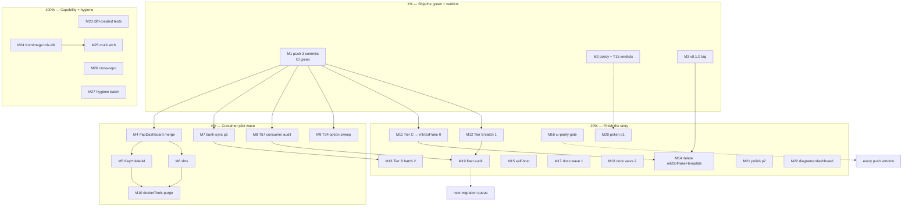

# Pareto Plan: Green Master → Fleet Value (post corpus-sweep)

**Created:** 2026-11-17 21:17 CET · **Repo state:** clean at `4594a9a`, 3 commits ahead of origin · **Authoritative living source:** `TODO_LIST.md` (T4–T71 + Blocked register); this plan ranks, it does not replace.

**Context (why the plan looks like this):** the docs corpus is fully truthful (2026-11-17 sweep: ~500 verdicts, 11 reports archived, battery 5/5 green, counts re-derived: 54 options / 17 container keys / 218 moduleTest / 72 pureFunctions). The OCI `container` option is built, tested, and **CI-green on origin through `6f5a76f`** (run 44164948028 — first green master since ≥2026-10-30). What remains is conversion work: turn a green, documented library into fleet-wide value — consumers shipping images on it, the deprecated paths deleted, and the verification gaps closed mechanically. The "customer" here is Lars + 34 consumer repos.

---

## Step 0 — Errata (verified while ranking; corrections on the record)

1. **The push question is 70% answered by events**: an external actor pushed through `6f5a76f` (CI green, 21:02 CET). What remains is pushing the last 3 commits (formatter-damage repair `ad0f44a` + status report `4594a9a` + the daemon's sweep of this plan). The plan's 1% tier shrinks accordingly — it was "push 10 + watch"; now "push 3 + watch".
2. **T47's premise refreshed**: origin carries the container option, so the PapDashboard relock is a plain `nix flake lock --update-input go-nix-helpers` — no path-override lane needed at merge time.
3. **T52/T57 evidence wording** ("daemon pushed master") was corrected 2026-11-17 to "push happened, actor unknown; daemon commits only" — no task content changed.
4. **18-52 f/9 (README OCI audit) is DONE** (docs-health VERIFY pass, 2026-11-17) — it never had a T-row; noted so no future harvest re-creates it.
5. **T65's F7 sub-item is done** (warning absent from moduleTest log, re-verified 2026-11-17) — the P23 leg shrinks to derivation-red proof + pandoc render.

---

## Step 1 — Pareto Breakdown

### The 1% that delivers 51%: **Ship the green + settle the three verdicts**

| # | Task | Why it is the 1% |
| - | --- | --- |
| 1 | Push the 3 remaining commits; watch CI stay green | Closes the red-origin window for good; makes the corpus sweep + container option public; every fleet migration is gated on it |
| 2 | Owner verdict batch: Won't-implement policy + T15 (templ-in-builds) | Two 15-min decisions that unblock the annotation canon (~210 unilateral verdicts pending ratification) and clear a BLOCKED row carried for 3 sessions |
| 3 | v0.1.0 tag decision (+ cut if approved) | Unlocks mkGoFlake removal, template deletion, and consumer version pinning — the entire G-series unblocks on this one yes/no |

### The 4% that delivers 64%: **The container pilot wave + fleet audit**

| # | Task | Why |
| - | --- | --- |
| 4 | T47 PapDashboard pilot merge (branch verified, relock now trivial) | The first fleet image shipped on the option; converts "tested" into "deployed" |
| 5 | T48 KeyHolderAI + T49 standard-bug-tracking-schema migrations | Two mechanical 2h migrations; every one deletes a hand-rolled image block |
| 6 | T50 bank-sync go-standard adoption | Largest remaining manual consumer; the pattern proof for Tier B |
| 7 | T57 post-push consumer audit (`nix flake update` sweeps) | Verifies nix2container lands transitively without breakage across the fleet |
| 8 | T34 option sweep (GOEXPERIMENT → `goExperiment`, cobra → `completionStyle`) | Deletes the most-repeated consumer boilerplate (7/10 Tier A repos) |

### The 20% that delivers 80%: **Finish the migration + hardening story**

| # | Task | Why |
| - | --- | --- |
| 9 | T4 Tier B migrations (6 repos) + T5 Tier C (2 repos) → mkGoFlake at ZERO consumers | Ends the two-pattern era; makes the deletion contract enforceable |
| 10 | G2+G3: delete `mkGoFlake.nix` + `templates/go-flake-parts` (post-tag) | Removes deprecated surface + the last stale `go_1_26` reference |
| 11 | T64 self-host: this repo's flake on `flakeModules.go-standard` | The dogfood gap that let a dead `systems` option and missing `passthru.go` survive; makes the module self-verifying |
| 12 | T56 ci-parity gate (shellcheck + `--all-systems --no-build` locally) + wire strict/bare-rows into the repo gate | The 2026-11-17 shfmt re-drift shipped because no local gate exists; closes the CI-vs-local gap mechanically |
| 13 | Container docs wave (T35 patterns, T37 checklist section, T44 tag docs, T45 registry auth, T46 workflow template, T53 skill note, T58 pin note, T59 tryEval pattern) | The adoption surface: docs are what consumers copy |
| 14 | T60 fleet audit re-run (auto-default + container checklist) | One pass produces the next migration queue for free |
| 15 | T65 polish batch P21–P26 (vendored-from marker, docs-gate extension, nix-health dirty-warn, derivation-red proof, pandoc render, assertion-count emission, floor-message edge tests, workflow_dispatch, old-nixpkgs pin policy) | Long-tail correctness, batched |
| 16 | T36 architecture diagram + T38 dashboard container column | Keep the two visual surfaces truthful |

### The other 20% (to 100%): capability, verification, cross-repo, hygiene

| # | Task group | Contents |
| - | --- | --- |
| 17 | Shipping capability | T39 richer structure diff, T40 `created` round-trip, T41 multi-arch manifest app, T42 `fromImage`, T43 `initializeNixDatabase` |
| 18 | Verification extras | T54 local aarch64 containerSmoke, T55 CI runtime delta review |
| 19 | Cross-repo | T61 SKILLS monorepo guidance, T62 SKILLS shellcheck pre-commit, T63 crush-config lessons export, T68 upstream ROUTED patch |
| 20 | Investigations + hygiene | T66 stray branch, T67 CI-run decompose, T69 unviewed snapshots + `result` symlink, T70 concurrent-actor detector, T71 heading-mode canon |
| 21 | Blocked register (external) | nixpkgs maintainer PR, SSH CI secret, df9a5ff rebase |
| 22 | Owner questions (ROADMAP) | allowed-tools enforcement, skill re-verification cadence, daemon WIP guard, second-actor identity |

---

## Step 2 — Comprehensive Plan (medium granularity, 30–100 min, ALL TODOs)

Sorted by importance / impact / effort / customer-value. `Effort` honest totals; `Value` = customer (fleet) impact H/M/L.

| # | Task | Tier | Effort | Value | Source | Depends on |
| -- | --- | --- | --- | --- | --- | --- |
| M1 | Push 3 remaining commits; verify CI green on the chain | 1% | 10min | H | g.1 answer | — |
| M2 | Owner verdict batch: Won't-implement policy + T15 close-out (update TODO_LIST + ROADMAP) | 1% | 30min | H | Blocked ×2 | — |
| M3 | v0.1.0 tag: cut (CHANGELOG section, annotated tag, `go get` validation) once approved | 1% | 60min | H | Blocked v0.1.0 | M1, CI green |
| M4 | T47 PapDashboard: merge pilot branch, relock, BuildFlow hooks clean, rebuild image + structure check | 4% | 45min | H | T47 | M1 |
| M5 | T48 KeyHolderAI: `container` option migration (config + image build + verify + docs row) | 4% | 100min | H | T48 | M4 (pattern) |
| M6 | T49 standard-bug-tracking-schema: `container` option migration | 4% | 100min | H | T49 | M4 (pattern) |
| M7 | T50 bank-sync: go-standard adoption, phase 1 (deps audit + module swap + vendorHash) | 4% | 100min | H | T50 | M1 |
| M8 | T57 post-push consumer audit: `nix flake update` sweep across the module fleet, record breakage | 4% | 60min | H | T57 | M1 |
| M9 | T34 consumer option sweep: GOEXPERIMENT boilerplate → `goExperiment`; cobra repos → `completionStyle` (batches of 3-4 repos) | 4% | 100min | H | T34 | M1 |
| M10 | T52 fleet sweep: delete remaining hand-rolled dockerTools blocks (after T47–T50) | 4% | 60min | M | T52 | M4–M7 |
| M11 | T5 Tier C: Standup-Killer + crush-daily off mkGoFlake → ZERO consumers | 20% | 60min | H | T5 | M1 |
| M12 | T4 Tier B migrations, batch 1 (KeyCountdown, branching-flow, StopTube) | 20% | 100min | H | T4 | M1 |
| M13 | T4 Tier B migrations, batch 2 (overview, bank-sync phase 2, BuildFlow) | 20% | 100min | H | T4 | M12, M7 |
| M14 | G2+G3: delete `mkGoFlake.nix` + `templates/go-flake-parts` + references + structural-check update | 20% | 45min | M | Blocked G2/G3 | M3, M11 |
| M15 | T64 self-host: import `flakeModules.go-standard` in this repo's flake; reconcile output parity | 20% | 100min | M | T64 | — |
| M16 | T56 ci-parity gate: `scripts/ci-parity.sh` (shellcheck + `--all-systems --no-build`) wired as check + wire writer strict/bare gates into repo gate | 20% | 100min | H | T56 + report f.8/9 | — |
| M17 | Container docs wave 1: T35 flake-patterns container section + T37 audit-checklist section + T46 GHCR workflow template (+Forgejo example) | 20% | 100min | M | T35/T37/T46 | — |
| M18 | Container docs wave 2: T44 tag-strategy docs + T45 README registry-auth section + T53 skill note + T58 lock-pin note + T59 tryEval pattern | 20% | 90min | M | T44/T45/T53/T58/T59 | — |
| M19 | T60 fleet audit re-run (auto-default + container checklist + manual-GOPRIVATE cleanup); publish updated tiers | 20% | 100min | H | T60 | M8, M12 |
| M20 | T65 polish batch P21–P26, part 1: vendored-from marker + docs-gate extension to planning/reviews + nix-health dirty-warn + dashboard canary line | 20% | 90min | L | T65 | — |
| M21 | T65 polish batch part 2: E2 derivation-red proof + pandoc `<del>` render check + assertion-count emission + floor-message edge tests + workflow_dispatch + old-nixpkgs pin policy | 20% | 90min | L | T65 | M20 |
| M22 | T36 architecture.d2/svg container component + T38 dashboard container column | 20% | 90min | L | T36/T38 | M17 |
| M23 | T39 structure-check richer jq diff + T40 custom-`created` round-trip test | 80→100% | 90min | M | T39/T40 | — |
| M24 | T42 `container.fromImage` (distroless base) + T43 `initializeNixDatabase` passthrough | 80→100% | 100min | M | T42/T43 | M5 pattern |
| M25 | T41 multi-arch manifest merge app (skopeo copy --all) | 80→100% | 100min | M | T41 | M24 |
| M26 | Cross-repo batch: T61 SKILLS monorepo guidance + T62 SKILLS shellcheck pre-commit + T63 crush-config lessons export | 80→100% | 90min | M | T61–T63 | — |
| M27 | Hygiene batch: T66 stray branch + T67 CI-run decompose + T69 unviewed snapshots & symlink + T70 actor detector + T71 heading canon + T54/T55 verification extras | 80→100% | 100min | L | T66/T67/T69/T70/T71/T54/T55 | — |

**Blocked register (not scheduled; external/owner-gated):** nixpkgs maintainer PR · SSH CI job (needs `DEPLOY_SSH_KEY`) · df9a5ff empty-message rebase · ROADMAP Open questions ×5. **Decided against:** postPatch extraction (L10).

---

## Step 3 — Detailed Breakdown (fine granularity, ≤12 min each, ALL TODOs)

Sorted by importance / impact / effort / customer-value. Honest rows: every multi-repo item is split per repo; batch rows carry their real per-unit effort in the note, never a 12-min label on 80 minutes of work (the 15.2 lesson).

| # | Fine task | Est | Parent |
| -- | --- | -- | --- |
| 1 | `git push origin master`; `gh run watch` the chain to green | 10min | M1 |
| 2 | Record CI verdict in AGENTS push-behavior note (green runs 44152413584 + new) | 5min | M1 |
| 3 | Won't-implement policy: write the verdict into ROADMAP Open-questions resolution | 10min | M2 |
| 4 | T15 close-out: strike Blocked row with verdict; annotate carrying reports' §g verdicts | 10min | M2 |
| 5 | Sweep TODO_LIST/ROADMAP for the policy's consequences (dormant-brush ratify note) | 10min | M2 |
| 6 | v0.1.0 prep: CHANGELOG release section from [Unreleased] | 12min | M3 |
| 7 | v0.1.0 cut: annotated tag + push tag + `go get` validation note | 10min | M3 |
| 8 | v0.1.0 post: delete TODO_BLOCKED row, note mkGoFlake removal unlocked | 5min | M3 |
| 9 | PapDashboard: `git stash` foreign files check → merge `oci-go-standard-pilot` | 10min | M4 |
| 10 | PapDashboard: relock go-nix-helpers; run BuildFlow hooks clean | 10min | M4 |
| 11 | PapDashboard: rebuild image + container-structure + full flake check | 10min | M4 |
| 12 | PapDashboard: end-to-end run (image-load + compose up + /health/ready probe) — owner-approved host mutation | 12min | M4 |
| 13 | PapDashboard: docs rows (CHANGELOG merge note, FEATURES flip) | 5min | M4 |
| 14 | KeyHolderAI: read current image wiring; write `container` block | 12min | M5 |
| 15 | KeyHolderAI: build image + structure check + eval | 12min | M5 |
| 16 | KeyHolderAI: docs row + commit | 10min | M5 |
| 17 | standard-bug-tracking-schema: same 3-step lane (config → verify → docs) | 30min (3×10) | M6 |
| 18 | bank-sync phase 1: deps audit vs go.mod requires | 12min | M7 |
| 19 | bank-sync phase 1: module swap + vendorHash cycle | 12min | M7 |
| 20 | bank-sync phase 1: build + tests green + commit | 12min | M7 |
| 21 | bank-sync phase 1: docs + AGENTS note | 10min | M7 |
| 22 | T57: list module-consuming repos from fleet inventory | 5min | M8 |
| 23 | T57: `nix flake update go-nix-helpers` sweep batch A (5 repos, eval each) | 12min | M8 |
| 24 | T57: sweep batch B (5 repos) | 12min | M8 |
| 25 | T57: sweep batch C (rest); record lock-diff table in TODO_LIST evidence | 12min | M8 |
| 26 | T57: fix any vendorHash bites via `buildflow -s nix-hash-fix --fix` | 12min | M8 |
| 27 | T34: grep fleet for GOEXPERIMENT boilerplate; build the repo list | 10min | M9 |
| 28 | T34: swap batch A (3 repos: extraBuildAttrs → `goExperiment`) | 12min | M9 |
| 29 | T34: swap batch B (3 repos) | 12min | M9 |
| 30 | T34: swap batch C (sbts incl. leftover + any stragglers) | 12min | M9 |
| 31 | T34: cobra `completionStyle` batch (all cobra repos) | 12min | M9 |
| 32 | T34: eval+build verify each swapped repo; commit per repo | 12min | M9 |
| 33 | T52: inventory remaining dockerTools blocks post-wave | 10min | M10 |
| 34 | T52: delete blocks + verify per repo batch A | 12min | M10 |
| 35 | T52: delete blocks + verify per repo batch B | 12min | M10 |
| 36 | Standup-Killer: migrate off mkGoFlake (subModules + doCheck=false lane) | 12min | M11 |
| 37 | Standup-Killer: build verify + commit | 10min | M11 |
| 38 | crush-daily: migrate (NixOS module via perSystem; drops its pin) | 12min | M11 |
| 39 | crush-daily: build verify + commit; record mkGoFlake ZERO consumers | 10min | M11 |
| 40 | KeyCountdown: rewrite flake on go-standard; eval | 12min | M12 |
| 41 | KeyCountdown: build + vendorHash + commit | 12min | M12 |
| 42 | branching-flow: rewrite (go-enum via extraBuildAttrs); eval | 12min | M12 |
| 43 | branching-flow: build + commit | 12min | M12 |
| 44 | StopTube: rewrite (G2 per-package attrs); eval | 12min | M12 |
| 45 | StopTube: build + commit | 12min | M12 |
| 46 | overview: rewrite (git-hooks input consumer-side; nixosModules perSystem) | 12min | M13 |
| 47 | overview: build + commit | 12min | M13 |
| 48 | bank-sync phase 2: monorepo `packages` split if multi-binary | 12min | M13 |
| 49 | BuildFlow: flake rewrite on multi-tool `packages` (1215-line flake, 3 slices) | 3×12min | M13 |
| 50 | BuildFlow: build all tool packages + commit | 12min | M13 |
| 51 | G2: delete `mkGoFlake.nix` + flake.nix export + structural check reference | 12min | M14 |
| 52 | G2: grep fleet for mkGoFlake references (expect zero); drop gotcha rows | 10min | M14 |
| 53 | G3: delete `templates/go-flake-parts` + README/template refs | 10min | M14 |
| 54 | G2/G3: CHANGELOG Removed entries + full check + commit | 10min | M14 |
| 55 | T64: map hand-rolled outputs vs module outputs (gap table) | 12min | M15 |
| 56 | T64: switch flake to `flakeModules.go-standard` imports | 12min | M15 |
| 57 | T64: reconcile custom checks (containerSmoke, moduleTests) via `checks` extension | 12min | M15 |
| 58 | T64: full parity verification + fmt + commit | 12min | M15 |
| 59 | T56: write `scripts/ci-parity.sh` (shellcheck + `--all-systems --no-build`) | 12min | M16 |
| 60 | T56: wire as flake check + smoke it red/green on planted drift | 12min | M16 |
| 61 | T56: add writer strict/bare-rows to the repo docs gate (re-vendor or invoke) | 12min | M16 |
| 62 | T56: shellcheck + nix fmt + commit | 10min | M16 |
| 63 | T35: flake-patterns.md container pattern section (happy path) | 12min | M17 |
| 64 | T35: anti-patterns (Dockerfile, dockerTools-for-shipping, why n2c) | 12min | M17 |
| 65 | T37: consumer-audit-checklist container section + triage script update | 12min | M17 |
| 66 | T46: GHCR push workflow template (consumer CI) | 12min | M17 |
| 67 | T46: Forgejo-remote doc example in migration guide | 10min | M17 |
| 68 | T44: tag-strategy knob docs (content-hash vs `self.rev`-derived) | 10min | M18 |
| 69 | T45: README registry-auth section (docker login / skopeo login) | 10min | M18 |
| 70 | T53: nix-private-go-repos skill: private-dep images push note | 10min | M18 |
| 71 | T58: nix2container lock-pin note (rev `42d1df94`) in docs | 5min | M18 |
| 72 | T59: tryEval message-free assert pattern → flake-patterns.md | 10min | M18 |
| 73 | T60: audit script prep (checklist v2 with container + auto-default columns) | 12min | M19 |
| 74 | T60: audit sweep 34 repos (3 batches × 12min) | 3×12min | M19 |
| 75 | T60: publish tier table + new migration queue into TODO_LIST | 12min | M19 |
| 76 | P21: vendored-from revision marker in check-rows.py header | 10min | M20 |
| 77 | P21: extend docs gates to `docs/planning` + `docs/reviews` | 12min | M20 |
| 78 | P22: nix-health dirty-tree warning | 10min | M20 |
| 79 | P22: dashboard.sh canary header line | 10min | M20 |
| 80 | P23: E2 derivation-level red proof (planted broken table, throwaway branch) | 12min | M21 |
| 81 | P23: pandoc `<del>` render verification of the strike corpus | 12min | M21 |
| 82 | P25: assertion-count emission in moduleTest output (drift tripwire) | 12min | M21 |
| 83 | P25: goModFloorMessage malformed-input tests ("1.x", "v1.26", empty) | 12min | M21 |
| 84 | P25: devShell `go` passthru parity check (or decide-against row) | 10min | M21 |
| 85 | P26: `workflow_dispatch` flake-check CI target | 10min | M21 |
| 86 | P26: old-nixpkgs pin refresh policy note | 10min | M21 |
| 87 | T36: architecture.d2 container.nix component + render svg | 12min | M22 |
| 88 | T38: dashboard.sh container column across fleet | 12min | M22 |
| 89 | T39: structure-check richer jq diff (localize first mismatch) | 12min | M23 |
| 90 | T39: negative-path moduleTest (gate REDS on tampered config) | 12min | M23 |
| 91 | T40: custom `created` round-trip test (RFC3339Nano edge) | 10min | M23 |
| 92 | T42: `container.fromImage` option + n2c fromImage wiring | 12min | M24 |
| 93 | T42: moduleTest + docs for fromImage | 12min | M24 |
| 94 | T43: `initializeNixDatabase` passthrough + docs | 12min | M24 |
| 95 | T41: multi-arch manifest app design (skopeo copy --all over per-system images) | 12min | M25 |
| 96 | T41: implement + smoke (x86_64 + aarch64 eval; build what's cheap) | 12min | M25 |
| 97 | T61: SKILLS monorepo+deps guidance in nix-private-go-repos skill | 12min | M26 |
| 98 | T62: shellcheck pre-commit for skill scripts (SKILLS repo) | 10min | M26 |
| 99 | T63: crush-config lessons export (toString-bools, tryEval, or-precedence, piped-exit) | 10min | M26 |
| 100 | T68: upstream ROUTED classification to docs-gates repo (issue or PR) | 12min | M26 |
| 101 | T66: inspect `origin/systemnix-vn-version-fix`; delete if dead | 10min | M27 |
| 102 | T67: decompose CI run 44059828196 (infra vs real) | 10min | M27 |
| 103 | T69: view review HTML + feedback + postmortem; trash `result` symlink | 12min | M27 |
| 104 | T70: concurrent-actor detector (mtime scan vs session edits) before declaring final | 12min | M27 |
| 105 | T71: heading-mode canon decision in annotate.go or skill docs | 12min | M27 |
| 106 | T54: local aarch64-linux containerSmoke build (emulation) | 12min | M27 |
| 107 | T55: GH Actions runtime delta review from containerSmoke | 10min | M27 |
| 108 | Maintainers PR prep (nixpkgs): module snippet + maintainer-list patch | 12min | Blocked |
| 109 | SSH CI job: flip `if: false` once `DEPLOY_SSH_KEY` secret exists | 10min | Blocked |
| 110 | df9a5ff: empty-message fixup via rebase (owner-approved force-with-lease) | 12min | Blocked |

**Counts (tool-checked, not arithmetic):** 110 rows; 96 scheduled fine tasks (incl. 3 explicit 3×12min batch rows: #17, #49, #74 — each names its real total), 14 rows in blocked/owner lanes. Medium plan: 27 tasks, 44.5h honest total (Tier-1% 1.7h, 4% 8.4h, 20% ~15h, remaining ~13h + 4.4h fine-only).

---

## Execution graph

**Verification gates (no Verschlimmbesserung):**

1. 1% tier: `gh run list` green on the pushed chain — nothing else starts before it.
2. Every consumer migration: eval + BUILD green in the consumer repo before commit; per-repo commit, chain `git add -A && git commit`.
3. Deletions (M14) only after M3+M11 (zero consumers proven by grep, not memory).
4. After any concurrent-session activity: re-run `nix fmt` + gates before pushing (2026-11-17 lesson, twice).
5. Local CI-parity before every push claim: shellcheck + `--all-systems --no-build` (until M16 makes it one command).
6. Plan rows that turn out done/stale get an errata note here, never a silent drop.

**New tasks surfaced by this plan → TODO_LIST:** T68 (upstream ROUTED), T69 (unviewed snapshots + symlink), T70 (actor detector), T71 (heading canon) — added 2026-11-17.
