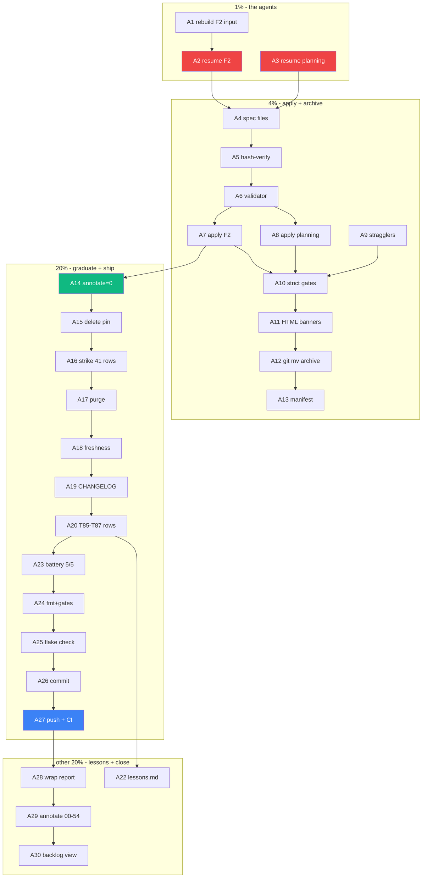

# Pareto Plan: Docs Corpus Completion — SUPERB Finish (2026-11-19 01:00)

> **Mission**: finish the docs-health execution the 00:54 owner report paused
> mid-flight: drain the annotate gate to **0**, resolve + archive the planning
> corpus, purge TODO_LIST DONE rows, cut CHANGELOG entries, verify everything,
> commit and **push** (explicitly ordered).
> **Inputs read first** (step 0): `TODO_LIST.md` (T72–T84 open + Blocked +
> Decided-against), `ROADMAP.md`, `docs/status/2026-11-19_00-54_*` (this
> session's owner report), battery state at `98dfc04` (freshness ✅ audit-all ✅
> annotate **68** routing ✅ cadence ✅; local gates 1+2 ✅).

## Errata (stale backlog corrected by this plan)

- The round-7 summary claimed `generate-flake.sh --templ/--private-deps` were
  removed — **false**; they survive as go-standard template features
  (verified via `--help` and `git log 9c8724b`). FEATURES.md was right.
- AGENTS.md's own count-derivation command was digit-unsafe — fixed in-session;
- "19-key container" (FEATURES/AGENTS) and "17-key" (README) were BOTH wrong:
  truth is **20** keys (`nix2container` contains a digit).

## Pareto breakdown

### The 1% that delivers 51%

**Resume the two interrupted subagents.** They hold verified method + context:
F2 drains the last 59 archived findings (annotate 68→~9: 59 A-class + D INFO

- 1 F/spacing); planning-corpus verdict-maps ~350 bare rows across 5 files.
  Everything else in this mission waits on their output.

### The 4% that delivers 64%

**Apply their specs + ARCHIVE.** Guarded applier → `check-rows` per wave →
`rows --strict` + `bare-rows` per file → `git mv` 4 planning MDs to
`docs/planning/archived/`, banner + archive the 2 HTML snapshots → **delete
`.docs-gates.json` at 0 findings** (fleet-default 0 = maximally strict; the
ratchet's terminal state).

### The 20% that delivers 80%

**Living-docs graduation + verification + ship**: strike/purge 41 TODO_LIST
DONE rows into CHANGELOG (`docs-gates purge`), cut `[Unreleased]` CHANGELOG
entries, harvest new rows (upstream candidates), full battery (expect 5/5 at
annotate=0) + `nix fmt` + `nix flake check --no-build`, detailed commit,
**push**, CI watch.

### The other 20% (to 100%)

Upstream lessons (docs-gates `append-verdict` mode, digit-class grep canon →
crush-config lessons.md), wrap-up status report + annotate the 00:54 report's
§f items, ROADMAP errata note, and honest routing of the standing cross-repo
backlog (T72–T84 + Blocked) — listed, dispositioned, NOT re-derived here.

## Level 1 — comprehensive plan (30–100 min; sorted by impact × effort)

| #   | Task                                                                                                                                                    | Impact                   | Effort | Why this order                            |
| --- | ------------------------------------------------------------------------------------------------------------------------------------------------------- | ------------------------ | ------ | ----------------------------------------- |
| P1  | Resume F2 agent (rebuild wiped /tmp input first) → drain last 59 archived findings                                                                      | Critical (mission gate)  | 30min  | The 1%; nothing else closes annotate      |
| P2  | Resume planning-corpus agent → verdict map for ~350 rows (5 files)                                                                                      | Critical (archive gate)  | 45min  | Parallel to P1; independent files         |
| P3  | Apply F2 + planning specs (guarded applier, hash-verify, check-rows per wave)                                                                           | Critical                 | 45min  | Converts agent output into repo truth     |
| P4  | Archive: gates per file → `git mv` 4 planning MDs + 2 HTML banners → `archived/`                                                                        | High                     | 45min  | The 4%; user-ordered "archive fully done" |
| P5  | Ratchet terminal: delete `.docs-gates.json` at 0 findings + AGENTS.md note                                                                              | High (policy)            | 15min  | Makes "0" the enforced state, not a pin   |
| P6  | TODO_LIST: strike 41 DONE rows → `docs-gates purge --apply` → CHANGELOG entry                                                                           | High (living-doc health) | 45min  | The 20%; TODO_LIST becomes open-work-only |
| P7  | CHANGELOG `[Unreleased]` + TODO_LIST harvest (upstream candidates T85+) + ROADMAP errata                                                                | Medium                   | 30min  | Living docs stay the single source        |
| P8  | Full verification: battery 5/5 @ annotate=0, local gates, `nix fmt`, `nix flake check --no-build`                                                       | Critical (do-not-break)  | 30min  | Ship gate                                 |
| P9  | Commit (very detailed) + **push** + `gh run watch`                                                                                                      | Critical (owner-ordered) | 30min  | Explicit order step 8                     |
| P10 | Wrap-up status report + annotate 00:54 report §f + final table view                                                                                     | Medium (ritual)          | 30min  | Closes the loop; keeps freshness green    |
| P11 | Standing backlog disposition (T72–T84 + Blocked + Decided-against): verify still-open, tick by reference where later repos show fixes, NO re-derivation | Medium                   | 30min  | "Include ALL TODOs" — honest routing      |
| P12 | Upstream lessons: lessons.md digit-class entry + docs-gates append-verdict issue row (T79 class)                                                        | Low-Medium               | 30min  | The other 20%; prevents recurrence        |

## Level 2 — atomic breakdown (≤12 min each; sorted by execution order then impact)

| #   | Task (atomic)                                                                                                                                               | ≤     | Feeds  |
| --- | ----------------------------------------------------------------------------------------------------------------------------------------------------------- | ----- | ------ |
| A1  | Rebuild `/tmp/gnh-batch-F.tsv` from battery output (6 files, 59 A-class lines + D/F classes)                                                                | 6min  | P1     |
| A2  | `agent_send` F2 agent: input rebuilt, re-emit spec only                                                                                                     | 2min  | P1     |
| A3  | `agent_send` planning agent: continue verdict map                                                                                                           | 2min  | P2     |
| A4  | Write spec-F2 + spec-planning files from agent reports (verbatim, TAB format)                                                                               | 12min | P3     |
| A5  | Hash-existence loop over every cited short hash (this repo + named foreign repos)                                                                           | 8min  | P3     |
| A6  | Validator pass: paths exist, linenos in-bounds, A-targets struck (refuse bare/headers)                                                                      | 6min  | P3     |
| A7  | Apply wave F2 (applier, atomic) + `check-rows` on the 6 touched files                                                                                       | 10min | P3     |
| A8  | Apply wave planning (applier/`repair` for bare rows) + `check-rows` on 5 files                                                                              | 12min | P3     |
| A9  | Fix any F/spacing or D-class stragglers the agents flag (micro-edits)                                                                                       | 10min | P3     |
| A10 | Per-file `rows --strict` + `bare-rows` over the 5 planning/feedback files                                                                                   | 8min  | P4     |
| A11 | Write dated resolution banners into the 2 HTML snapshots (06-19 review, 07-24 plan)                                                                         | 10min | P4     |
| A12 | `mkdir`-via-`git mv`: 4 planning MDs → `docs/planning/archived/`; review HTML → `docs/reviews/archived/`; feedback stays in `processed/` (already terminal) | 6min  | P4     |
| A13 | Archive manifest (one line per moved file, classification + reason) in wrap-up report                                                                       | 6min  | P4/P10 |
| A14 | Battery annotate run → confirm **0** findings (if >0: targeted drain loop)                                                                                  | 6min  | P5     |
| A15 | `git rm .docs-gates.json`; AGENTS.md ratchet note → "drained to 0 on 2026-11-19; pin removed (default 0 = strictest)"                                       | 6min  | P5     |
| A16 | TODO_LIST: strike all 41 DONE rows (docs-strike semantics: status wrap + verdict)                                                                           | 12min | P6     |
| A17 | `docs-gates purge --apply` (dry-run first) → CHANGELOG purge entry lands                                                                                    | 8min  | P6     |
| A18 | Battery freshness re-run (purge moved tokens into CHANGELOG — must stay FRESH)                                                                              | 4min  | P6     |
| A19 | CHANGELOG `[Unreleased]`: corpus-drain + living-doc accuracy entries                                                                                        | 10min | P7     |
| A20 | TODO_LIST: add T85 (docs-gates append-verdict mode), T86 (separator normalizer sweep), T87 (spec-files-not-chat agent protocol) with evidence pointers      | 8min  | P7     |
| A21 | ROADMAP: errata note (counts now tool-derived; digit-safe canon) if not already implicit                                                                    | 6min  | P7     |
| A22 | crush-config lessons.md: digit-class grep lesson + spec-map fabrication lesson (cross-repo commit)                                                          | 12min | P12    |
| A23 | Full `docs-gates run .` — require 5/5 PASS                                                                                                                  | 6min  | P8     |
| A24 | `bash scripts/check-docs-annotations.sh` + `nix fmt` + verify no diff                                                                                       | 8min  | P8     |
| A25 | `nix flake check --no-build` (clean-tree recipe if dirty-GC bites: worktree at HEAD)                                                                        | 10min | P8     |
| A26 | `git status` review → detailed commit (chained `git add -A && git commit`)                                                                                  | 8min  | P9     |
| A27 | `git push origin master` + `gh run watch` (or list) → CI green                                                                                              | 10min | P9     |
| A28 | Wrap-up report `docs/status/2026-11-19_*_docs-corpus-completion.md` (a–g + manifest)                                                                        | 12min | P10    |
| A29 | Annotate 00:54 report §f items 1–6 resolved inline (done-at commit hashes)                                                                                  | 6min  | P10    |
| A30 | Standing-backlog table view inline (T72–T84 dispositions, merge-by-reference ticks only)                                                                    | 10min | P11    |

## Execution graph

## Verification gates (per tier)

- Every apply wave: `check-rows` over touched files + battery annotate count must DROP monotonically.
- Archive: `rows --strict` + `bare-rows` pass BEFORE each `git mv` (gate-before-move canon).
- Purge: dry-run output reviewed; freshness gate re-green AFTER purge (CHANGELOG carries the tokens).
- Ship: battery 5/5 + local gates + `nix fmt` no-op + `flake check --no-build` + CI green on origin.

## Verschlimmbessung guards

- No rewrites of historical files beyond verdict insertion (guarded applier only; A-refuses-bare; R-only for D-class contradictions).
- No invented hashes: hash-existence loop before every application (burned 3× this session — the guard is the canon).
- Purge is reversible via CHANGELOG entry; pin deletion only AFTER annotate=0 confirmed twice.
- Standing cross-repo rows are TICKED BY REFERENCE only (grep the named repo's history), never re-derived from greps here.

## Sources

- `docs/status/2026-11-19_00-54_docs-health-corpus-drain.md` (§a–§g)
- Battery output at `98dfc04`; `TODO_LIST.md`; `ROADMAP.md`
- docs-health SKILL (ANNOTATE/ARCHIVE canon), pareto-planning SKILL

_Point-in-time snapshot · 2026-11-19 01:00 · living source: `TODO_LIST.md`_
