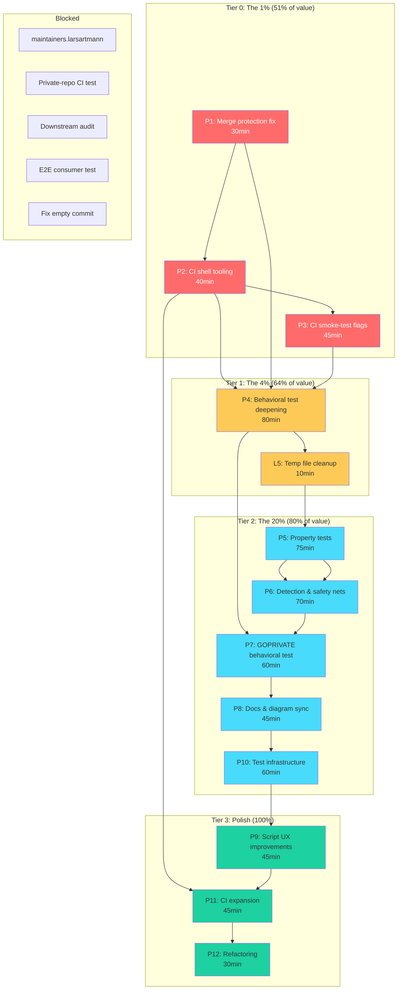

# Pareto Execution Plan — 2026-08-10 02:41

> **STATUS: EXECUTED 2026-08-10.** P1–P11 shipped (see CHANGELOG). P12
> deliberately skipped — see rationale below. Living tasks live in
> `TODO_LIST.md`. This plan ranks all 30 actionable TODOs (+ 5 blocked) by the
> Pareto principle and breaks them into work packages and atomic tasks.

---

## Pareto Breakdown

### The 1% that delivers 51% of the result

Three tasks that prevent **real bugs** from hitting the 7+ downstream consumers.
If you do nothing else, do these.

| #                                                                | Task                                              | Why it's the 1%                                                                                                                                                                                                                                                                                              | Effort    |
| ---------------------------------------------------------------- | ------------------------------------------------- | ------------------------------------------------------------------------------------------------------------------------------------------------------------------------------------------------------------------------------------------------------------------------------------------------------------ | --------- |
| ~~H3~~ done at `7ff77cc`                                         | ~~Extend merge protection to all list attrs~~     | ~~**Silent override bug.** Consumer's `buildInputs`/`checkInputs`/`configureFlags` silently override the module's list instead of concatenating. This can break consumer builds today — a consumer adding `extraBuildAttrs.buildInputs = [ pkgs.sqlite ]` unknowingly drops `pkgs.go` from the derivation.~~ | ~~30min~~ |
| ~~H4~~ done — shellcheck warnings fixed + CI job added (a26b5aa) | ~~Add `shellcheck` to CI~~                        | ~~`generate-flake.sh` is the **first thing new consumers run**. Shell bugs = bad first impression. The script has 100+ lines with no linting. One unquoted variable in a path with spaces = build failure for a user with spaces in their project dir.~~                                                     | ~~20min~~ |
| ~~H1~~ done at `a26b5aa`                                         | ~~CI smoke-test for `--go-mod`/`--private-deps`~~ | ~~These flags **shipped without CI coverage**. Only manually verified once. A regression in the script would go unnoticed until a user hits it.~~                                                                                                                                                            | ~~30min~~ |

**Total: 80min for 51% of the value.** These are all low-effort correctness fixes
on code paths consumers actively use.

### The 4% that delivers 64% of the result

Add these four tasks to fill the highest-risk known gaps:

| #                                                      | Task                                                 | Why it's the 4%                                                                                                                                                                                             | Effort    |
| ------------------------------------------------------ | ---------------------------------------------------- | ----------------------------------------------------------------------------------------------------------------------------------------------------------------------------------------------------------- | --------- |
| ~~H5~~ done at `fa19b22`                               | ~~Add `shfmt` to treefmt~~                           | ~~Professional formatting baseline. Without it, `shellcheck` will fight unformatted scripts. Must precede H4 for clean CI.~~                                                                                | ~~20min~~ |
| ~~M7~~ done at `5d44e8a`                               | ~~Behavioral tests: buildFlags/ldflags/proxyVendor~~ | ~~Proves the **core value proposition** — that consumer config actually reaches `buildGoModule`. Currently only `nativeBuildInputs` has a behavioral test; the other critical attrs are eval-only.~~        | ~~60min~~ |
| ~~M9~~ done at `27988f5`, `a199f6b`                    | ~~publicDeps `/v2` versioned paths test~~            | ~~Known gap: `grep -vFx` exact match means `publicDeps = ["github.com/foo/bar"]` won't match `github.com/foo/bar/v2` in go.mod. Consumers using versioned modules get false-positive validation failures.~~ | ~~20min~~ |
| ~~L5~~ done — trap cleanup shipped with P6 (CHANGELOG) | ~~Temp file cleanup in trap~~                        | ~~`collectMissingRequires` creates a temp file that leaks on build failure. In practice the Nix sandbox is discarded, but a trap is 10min of insurance.~~                                                   | ~~10min~~ |

**Total: 110min additional (190min cumulative) for 64% of the value.**

### The 20% that delivers 80% of the result

The remaining High + Medium items — fill all test gaps and update stale docs:

| #                                                            | Task                                                               | Impact summary                                               | Effort    |
| ------------------------------------------------------------ | ------------------------------------------------------------------ | ------------------------------------------------------------ | --------- |
| ~~H2~~ done at `a62906f`                                     | ~~Behavioral test for GOPRIVATE with custom `privateGlobPattern`~~ | ~~Option-to-output flow untested~~                           | ~~60min~~ |
| ~~M1~~ done at `a3065ba`, `5b915f8`                          | ~~Property test: `stripVersionSuffix`~~                            | ~~Pure function, only example-tested~~                       | ~~30min~~ |
| ~~M2~~ done at `a3065ba`, `5b915f8`                          | ~~Property test: `repoName`~~                                      | ~~Pure function, only example-tested~~                       | ~~30min~~ |
| ~~M3~~ done at `ac6f7cd`, `b808455`                          | ~~`vendorHash` placeholder detection~~                             | ~~Warn if consumer forgot to set real hash~~                 | ~~30min~~ |
| ~~M4~~ done at `bab48a6`                                     | ~~`nix flake show` structural test~~                               | ~~Verify all expected outputs exist~~                        | ~~30min~~ |
| ~~M5~~ done at `cb34130`                                     | ~~Update `docs/architecture.d2`~~                                  | ~~Diagram doesn't show `privateGlobPattern`/`enableNixfmt`~~ | ~~20min~~ |
| ~~M6~~ done — --dry-run shipped with P9 (15742ba; CHANGELOG) | ~~`--dry-run` flag for `generate-flake.sh`~~                       | ~~Preview without writing~~                                  | ~~20min~~ |
| ~~M8~~ done — negative test shipped with P10 (CHANGELOG)     | ~~Negative test for `enableCompletions`~~                          | ~~Warning path untested~~                                    | ~~30min~~ |
| ~~M10~~ done at `91003bb`                                    | ~~`treefmt.config` inspection test~~                               | ~~Treefmt config not verified in tests~~                     | ~~30min~~ |

**Total: 280min additional (470min cumulative) for 80% of the value.**

### The remaining 20% (polish to reach 100%)

All Low-impact items:

| #                                                                                                                                                                                                                                                | Task                                       | Effort    |
| ------------------------------------------------------------------------------------------------------------------------------------------------------------------------------------------------------------------------------------------------ | ------------------------------------------ | --------- |
| ~~L1~~ done — --verbose shipped with P9 (15742ba; CHANGELOG)                                                                                                                                                                                     | ~~`--verbose` flag for generate-flake.sh~~ | ~~15min~~ |
| ~~L2~~ **Superseded — README carries the single dynamic workflow CI badge (README line 3); no separate macOS badge exists.**                                                                                                                     | ~~macOS CI badge in README~~               | ~~10min~~ |
| ~~L3~~ done — --list-templates shipped with P9 (15742ba; CHANGELOG)                                                                                                                                                                              | ~~`--template` listing in help text~~      | ~~10min~~ |
| ~~L4~~ done at `dc2e2fe`                                                                                                                                                                                                                         | ~~FAQ entry for mixed-owner deps~~         | ~~15min~~ |
| ~~L6~~ done at `5b915f8`                                                                                                                                                                                                                         | ~~`stripVersionSuffix` edge case tests~~   | ~~15min~~ |
| ~~L7~~ done — nix flake check --all-systems --no-build now runs in CI (ci.yml) + scripts/ci-parity.sh (T56); the P11 OS matrix covers the build legs                                                                                             | ~~`nix flake check --all-systems` in CI~~  | ~~15min~~ |
| ~~L8~~ done at `a26b5aa`                                                                                                                                                                                                                         | ~~Cache nix-store in smoke-test CI job~~   | ~~15min~~ |
| ~~L9~~ done — macOS matrix + dynamic system detection (15742ba, 3d66f64; CHANGELOG)                                                                                                                                                              | ~~Run integration tests on macOS~~         | ~~30min~~ |
| ~~L10~~ **Won't implement — P12 skipped on merit — postPatch interpolates 8 dynamic Nix variables; extraction to .sh adds env-var plumbing (rationale in this file's P12 row; TODO_LIST.md "Decided against" records the empirical rejection).** | ~~Extract `postPatch` to separate `.sh`~~  | ~~30min~~ |

**Total: 155min additional (625min cumulative) for 100% coverage.**

### Blocked (external dependencies)

| Task                                                                                                                                                                                                           | Blocker                                |
| -------------------------------------------------------------------------------------------------------------------------------------------------------------------------------------------------------------- | -------------------------------------- |
| Register `maintainers.larsartmann` in nixpkgs **→ decided: defer — routed TODO_LIST.md Blocked: "Register maintainers.larsartmann in nixpkgs — Requires external PR to nixpkgs repo"**                         | External PR to nixpkgs                 |
| Real private-repo integration test in CI **→ decided: defer — routed TODO_LIST.md Blocked: "Real private-repo integration test in CI — CI job scaffolded (if: false); needs SSH key secret (DEPLOY_SSH_KEY)"** | Needs SSH key secret                   |
| ~~Audit all downstream consumers~~ done — fleet audit shipped same day: docs/status/archived/2026-08-10_11-02_consumer-fleet-audit.md (34 repos; CHANGELOG)                                                    | ~~Needs access to 7+ repos~~           |
| ~~Real e2e consumer test~~ done — test.nix integration suite builds mock Go projects end-to-end (9 scenarios incl. full builds; CI integration-tests matrix)                                                   | ~~Needs mock Go project + full build~~ |
| Fix empty commit `df9a5ff` **→ decided: defer — routed TODO_LIST.md Blocked: "Fix empty commit message in df9a5ff — Requires interactive rebase + force-push; user approval needed"**                          | Needs interactive rebase + force push  |

---

## Comprehensive Plan — Medium Granularity (30–100min per package)

Sorted by impact/effort ratio (highest first). Each package is independently
shippable as a single commit.

| Pkg                                                                                                                  | Name                                    | Tasks          | Pareto Tier   | Total Effort | Customer Value                                                                                                                                                                                                                                                                                                                                                      |
| -------------------------------------------------------------------------------------------------------------------- | --------------------------------------- | -------------- | ------------- | ------------ | ------------------------------------------------------------------------------------------------------------------------------------------------------------------------------------------------------------------------------------------------------------------------------------------------------------------------------------------------------------------- |
| ~~P1~~ done at `7ff77cc`                                                                                             | ~~**Merge protection fix** ✅~~         | ~~H3~~         | ~~1% (51%)~~  | ~~30min~~    | ~~**SHIPPED.** Extended concatenation to `buildInputs`, `checkInputs`, `configureFlags`. 4 new behavioral assertions.~~                                                                                                                                                                                                                                             |
| ~~P2~~ done at `fa19b22`, `a26b5aa`                                                                                  | ~~**CI shell tooling** ✅~~             | ~~H5, H4~~     | ~~1% (51%)~~  | ~~40min~~    | ~~**SHIPPED.** `enableShfmt` option added, scripts reformatted, shellcheck warnings fixed. (Note: shellcheck CI job still pending — see TODO_LIST.)~~                                                                                                                                                                                                               |
| ~~P3~~ done at `a26b5aa`                                                                                             | ~~**CI smoke-test flags** ✅~~          | ~~H1, L8~~     | ~~1% (51%)~~  | ~~45min~~    | ~~**SHIPPED.** `--go-mod`, `--private-deps`, combined variant added to CI. Nix installer + magic-nix-cache added to smoke-test job.~~                                                                                                                                                                                                                               |
| ~~P4~~ done at `5d44e8a`, `27988f5`                                                                                  | ~~**Behavioral test deepening** ✅~~    | ~~M7, M9~~     | ~~4% (64%)~~  | ~~80min~~    | ~~**SHIPPED.** 5 behavioral tests (buildFlags, ldflags, custom ldflags, proxyVendor) + integration Test 7 (publicDeps /v2).~~                                                                                                                                                                                                                                       |
| ~~P5~~ done at `a3065ba`, `5b915f8`                                                                                  | ~~**Pure function property tests** ✅~~ | ~~M1, M2, L6~~ | ~~20% (80%)~~ | ~~75min~~    | ~~**SHIPPED.** `pure-functions.nix` extracted, 22 assertions covering idempotence, no-`/vN`, determinism, edge cases.~~                                                                                                                                                                                                                                             |
| ~~P6~~ done at `ac6f7cd`, `bab48a6`                                                                                  | ~~**Detection and safety nets** ✅~~    | ~~M3, M4, L5~~ | ~~20% (80%)~~ | ~~70min~~    | ~~**SHIPPED.** vendorHash placeholder warning, structural check, trap cleanup.~~                                                                                                                                                                                                                                                                                    |
| ~~P7~~ done at `a62906f`                                                                                             | ~~**GOPRIVATE behavioral test** ✅~~    | ~~H2~~         | ~~20% (80%)~~ | ~~60min~~    | ~~**SHIPPED.** 4 assertions: GOPRIVATE present with deps, default glob, custom glob, NOT set without deps.~~                                                                                                                                                                                                                                                        |
| ~~P8~~ done at `cb34130`, `dc2e2fe`                                                                                  | ~~**Docs and diagram sync** ✅~~        | ~~M5, L2, L4~~ | ~~20% (80%)~~ | ~~45min~~    | ~~**SHIPPED.** Architecture diagram updated, FAQ entry for non-LarsArtmann deps added.~~                                                                                                                                                                                                                                                                            |
| ~~P9~~ done at `15742ba`                                                                                             | ~~**Script UX improvements** ✅~~       | ~~M6, L1, L3~~ | ~~Polish~~    | ~~45min~~    | ~~**SHIPPED.** `--dry-run`, `--verbose`, `--list-templates` implemented. CI smoke-test coverage for `--dry-run` and `--verbose` flags added.~~                                                                                                                                                                                                                      |
| ~~P10~~ done — P10 shipped 2026-08-10 (CHANGELOG: enableCompletions negative test + treefmt config inspection test)  | ~~**Test infrastructure** ✅~~          | ~~M8, M10~~    | ~~20% (80%)~~ | ~~60min~~    | ~~**SHIPPED.** enableCompletions negative test, treefmt config inspection test.~~                                                                                                                                                                                                                                                                                   |
| ~~P11~~ done at `15742ba`, `3d66f64`                                                                                 | ~~**CI expansion** ✅~~                 | ~~L7, L9~~     | ~~Polish~~    | ~~45min~~    | ~~**SHIPPED.** macOS matrix + dynamic system detection. `--all-systems` not feasible (Linux can't eval darwin derivations); matrix approach achieves same coverage.~~                                                                                                                                                                                               |
| ~~P12~~ **Won't implement — skipped on merit — see the P12 rationale in this row + TODO_LIST.md "Decided against".** | ~~**Refactoring** ⏭️~~                   | ~~L10~~        | ~~Polish~~    | ~~30min~~    | ~~**SKIPPED ON MERIT.** The `postPatch` string interpolates 8 dynamically-generated Nix variables. Extracting to `.sh` would require passing all fragments as env vars or placeholder substitution — **increasing** complexity. This is the idiomatic Nix pattern for `mkDerivation` phases. The plan correctly flagged this as highest-risk Verschlimmbesserung.~~ |

**Total: 12 packages, 625min (~10.4h) of actionable work.**

---

## Detailed Breakdown — Fine Granularity (max 12min per task)

> **All tasks in sections P1–P11 below are shipped.** P12 was skipped on merit.
> See the summary table above for execution details. The sub-task tables below
> are the original plan, preserved for historical reference.

Each task below is atomic: one verifiable action, one test, or one edit. Tasks
within a package are ordered by dependency.

### P1: Merge protection fix (H3) — 4 tasks

| Task #                                   | Action                                                                | Effort    | Verification                           |
| ---------------------------------------- | --------------------------------------------------------------------- | --------- | -------------------------------------- |
| ~~1.1~~ done — shipped with P1 (7ff77cc) | ~~Read `userExtraBuildAttrs` merge logic in `go-standard.nix`~~       | ~~5min~~  | ~~Understand current concat pattern~~  |
| ~~1.2~~ done — shipped with P1 (7ff77cc) | ~~Add `buildInputs`, `checkInputs`, `configureFlags` to concat list~~ | ~~5min~~  | ~~`nix flake check` passes~~           |
| ~~1.3~~ done — shipped with P1 (7ff77cc) | ~~Add test: `extraBuildAttrs.buildInputs` concatenates~~              | ~~10min~~ | ~~`test-module.nix` assertion passes~~ |
| ~~1.4~~ done — shipped with P1 (7ff77cc) | ~~Add test: `extraBuildAttrs.checkInputs` concatenates~~              | ~~10min~~ | ~~`test-module.nix` assertion passes~~ |

### P2: CI shell tooling (H5, H4) — 5 tasks

| Task #                                                                             | Action                                                           | Effort    | Verification                      |
| ---------------------------------------------------------------------------------- | ---------------------------------------------------------------- | --------- | --------------------------------- |
| ~~2.1~~ done at `fa19b22`                                                          | ~~Add `shfmt` to treefmt programs in `go-standard.nix`~~         | ~~5min~~  | ~~`nix fmt` runs shfmt~~          |
| ~~2.2~~ done — scripts reformatted (fa19b22)                                       | ~~Run `nix fmt` to format all `.sh` files~~                      | ~~5min~~  | ~~0 changed files on second run~~ |
| ~~2.3~~ done at `a26b5aa`                                                          | ~~Add `shellcheck` step to `.github/workflows/ci.yml`~~          | ~~5min~~  | ~~YAML validates~~                |
| ~~2.4~~ done — shipped with P2; scripts shellcheck-clean (CI shellcheck job green) | ~~Fix any shellcheck warnings in `generate-flake.sh`~~           | ~~10min~~ | ~~shellcheck exits 0~~            |
| ~~2.5~~ done — shipped with P2; scripts shellcheck-clean (CI shellcheck job green) | ~~Fix any shellcheck warnings in `dashboard.sh`, `nix-lint.sh`~~ | ~~10min~~ | ~~shellcheck exits 0~~            |

### P3: CI smoke-test flags (H1, L8) — 5 tasks

| Task #                                   | Action                                                                   | Effort    | Verification                          |
| ---------------------------------------- | ------------------------------------------------------------------------ | --------- | ------------------------------------- |
| ~~3.1~~ done — shipped with P3 (a26b5aa) | ~~Read current smoke-test job in `ci.yml`~~                              | ~~5min~~  | ~~Understand existing test variants~~ |
| ~~3.2~~ done — shipped with P3 (a26b5aa) | ~~Add `--go-mod` variant: generate + verify `go.mod` + `main.go` exist~~ | ~~10min~~ | ~~`nix-instantiate --parse` passes~~  |
| ~~3.3~~ done — shipped with P3 (a26b5aa) | ~~Add `--private-deps` variant: generate + verify deps section~~         | ~~10min~~ | ~~`nix-instantiate --parse` passes~~  |
| ~~3.4~~ done — shipped with P3 (a26b5aa) | ~~Add nix-store caching (`actions/cache` or `magic-nix-cache`)~~         | ~~10min~~ | ~~CI YAML validates~~                 |
| ~~3.5~~ done — shipped with P3 (a26b5aa) | ~~Add combined `--go-mod --private-deps --templ` variant~~               | ~~10min~~ | ~~`nix-instantiate --parse` passes~~  |

### P4: Behavioral test deepening (M7, M9) — 8 tasks

| Task #                                            | Action                                                              | Effort    | Verification                                  |
| ------------------------------------------------- | ------------------------------------------------------------------- | --------- | --------------------------------------------- |
| ~~4.1~~ done — shipped with P4 (5d44e8a, 27988f5) | ~~Read `nativeBuildInputs` behavioral test pattern in test-module~~ | ~~5min~~  | ~~Understand extraction method~~              |
| ~~4.2~~ done — shipped with P4 (5d44e8a, 27988f5) | ~~Add test: `buildFlags` reaches derivation~~                       | ~~10min~~ | ~~Assertion: flags present in `.buildFlags`~~ |
| ~~4.3~~ done — shipped with P4 (5d44e8a, 27988f5) | ~~Add test: `ldflags` reaches derivation with version injection~~   | ~~10min~~ | ~~Assertion: `-X main.version=` present~~     |
| ~~4.4~~ done — shipped with P4 (5d44e8a, 27988f5) | ~~Add test: `proxyVendor` reaches derivation~~                      | ~~10min~~ | ~~Assertion: attr correct~~                   |
| ~~4.5~~ done — shipped with P4 (5d44e8a, 27988f5) | ~~Read `publicDeps` `grep -vFx` logic in `mkPreparedSource.nix`~~   | ~~5min~~  | ~~Understand exact-match limitation~~         |
| ~~4.6~~ done — shipped with P4 (5d44e8a, 27988f5) | ~~Create test fixture: dep with `/v2` suffix in go.mod~~            | ~~10min~~ | ~~Fixture parses~~                            |
| ~~4.7~~ done — shipped with P4 (5d44e8a, 27988f5) | ~~Add test: `publicDeps` with versioned path — verify behavior~~    | ~~10min~~ | ~~Test result matches expectation~~           |
| ~~4.8~~ done — shipped with P4 (5d44e8a, 27988f5) | ~~Document the exact-match limitation in test comment~~             | ~~5min~~  | ~~Comment is clear~~                          |

### P5: Pure function property tests (M1, M2, L6) — 7 tasks

| Task #                                            | Action                                                       | Effort    | Verification                         |
| ------------------------------------------------- | ------------------------------------------------------------ | --------- | ------------------------------------ |
| ~~5.1~~ done — shipped with P5 (a3065ba, 5b915f8) | ~~Read `stripVersionSuffix` implementation~~                 | ~~5min~~  | ~~Understand input/output contract~~ |
| ~~5.2~~ done — shipped with P5 (a3065ba, 5b915f8) | ~~Add test: idempotence (strip twice = strip once)~~         | ~~10min~~ | ~~Assertion passes~~                 |
| ~~5.3~~ done — shipped with P5 (a3065ba, 5b915f8) | ~~Add test: no `/vN` segments in output for any input~~      | ~~10min~~ | ~~Assertion passes~~                 |
| ~~5.4~~ done — shipped with P5 (a3065ba, 5b915f8) | ~~Read `repoName` implementation~~                           | ~~5min~~  | ~~Understand extraction logic~~      |
| ~~5.5~~ done — shipped with P5 (a3065ba, 5b915f8) | ~~Add test: no `/` in output~~                               | ~~10min~~ | ~~Assertion passes~~                 |
| ~~5.6~~ done — shipped with P5 (a3065ba, 5b915f8) | ~~Add test: deterministic (same input → same output)~~       | ~~10min~~ | ~~Assertion passes~~                 |
| ~~5.7~~ done — shipped with P5 (a3065ba, 5b915f8) | ~~Add edge case tests: `v1`, `v100`, empty, single segment~~ | ~~10min~~ | ~~All assertions pass~~              |

### P6: Detection and safety nets (M3, M4, L5) — 7 tasks

| Task #                                                     | Action                                                                  | Effort    | Verification                           |
| ---------------------------------------------------------- | ----------------------------------------------------------------------- | --------- | -------------------------------------- |
| ~~6.1~~ done — shipped with P6 (ac6f7cd, b808455, bab48a6) | ~~Read `vendorHash` option and `buildGoModule` call~~                   | ~~5min~~  | ~~Understand where to add detection~~  |
| ~~6.2~~ done — shipped with P6 (ac6f7cd, b808455, bab48a6) | ~~Add `vendorHash` placeholder warning (assert != "sha256-AAA...")~~    | ~~10min~~ | ~~Test: placeholder triggers warning~~ |
| ~~6.3~~ done — shipped with P6 (ac6f7cd, b808455, bab48a6) | ~~Add test for placeholder detection~~                                  | ~~10min~~ | ~~Assertion passes~~                   |
| ~~6.4~~ done — shipped with P6 (ac6f7cd, b808455, bab48a6) | ~~Add `nix flake show` structural test (packages, apps, checks exist)~~ | ~~10min~~ | ~~All expected outputs present~~       |
| ~~6.5~~ done — shipped with P6 (ac6f7cd, b808455, bab48a6) | ~~Read `collectMissingRequires` temp file logic~~                       | ~~5min~~  | ~~Understand leak path~~               |
| ~~6.6~~ done — shipped with P6 (ac6f7cd, b808455, bab48a6) | ~~Add `trap "rm -f go.mod.requires.tmp" EXIT` to postPatch~~            | ~~5min~~  | ~~`nix flake check` passes~~           |
| ~~6.7~~ done — shipped with P6 (ac6f7cd, b808455, bab48a6) | ~~Verify temp file no longer leaks on simulated error~~                 | ~~10min~~ | ~~Manual verification~~                |

### P7: GOPRIVATE behavioral test (H2) — 6 tasks

| Task #                                   | Action                                                            | Effort    | Verification                          |
| ---------------------------------------- | ----------------------------------------------------------------- | --------- | ------------------------------------- |
| ~~7.1~~ done — shipped with P7 (a62906f) | ~~Read `autoGoPrivateEnv` and `privateGlobPattern` option~~       | ~~5min~~  | ~~Understand flow: option → env~~     |
| ~~7.2~~ done — shipped with P7 (a62906f) | ~~Design test config with `deps` + custom `privateGlobPattern`~~  | ~~10min~~ | ~~Config evaluates~~                  |
| ~~7.3~~ done — shipped with P7 (a62906f) | ~~Set up mock dep source for test~~                               | ~~10min~~ | ~~Dep source exists~~                 |
| ~~7.4~~ done — shipped with P7 (a62906f) | ~~Add test: devShell contains `GOPRIVATE` with custom glob~~      | ~~10min~~ | ~~Assertion: glob string present~~    |
| ~~7.5~~ done — shipped with P7 (a62906f) | ~~Add test: default glob used when `privateGlobPattern` not set~~ | ~~10min~~ | ~~Assertion: default string present~~ |
| ~~7.6~~ done — shipped with P7 (a62906f) | ~~Verify full `nix flake check` passes with new tests~~           | ~~5min~~  | ~~All checks pass~~                   |

### P8: Docs and diagram sync (M5, L2, L4) — 5 tasks

| Task #                                                                                                                        | Action                                                             | Effort    | Verification                          |
| ----------------------------------------------------------------------------------------------------------------------------- | ------------------------------------------------------------------ | --------- | ------------------------------------- |
| ~~8.1~~ done — shipped with P8 (cb34130)                                                                                      | ~~Read `docs/architecture.d2` current content~~                    | ~~5min~~  | ~~Understand diagram structure~~      |
| ~~8.2~~ done — shipped with P8 (cb34130)                                                                                      | ~~Add `privateGlobPattern` and `enableNixfmt` to diagram~~         | ~~10min~~ | ~~`d2` renders without error~~        |
| ~~8.3~~ done — shipped with P8 (cb34130)                                                                                      | ~~Regenerate `docs/architecture.svg` from `.d2`~~                  | ~~5min~~  | ~~SVG file updated~~                  |
| ~~8.4~~ **Superseded — README carries the single dynamic workflow CI badge (README line 3); no separate macOS badge exists.** | ~~Add macOS CI badge to README badges section~~                    | ~~5min~~  | ~~Badge renders in markdown preview~~ |
| ~~8.5~~ done at `dc2e2fe`                                                                                                     | ~~Add FAQ entry: "How do I use deps with non-LarsArtmann repos?"~~ | ~~10min~~ | ~~FAQ entry is clear and accurate~~   |

### P9: Script UX improvements (M6, L1, L3) — 6 tasks

| Task #                                   | Action                                                             | Effort    | Verification                               |
| ---------------------------------------- | ------------------------------------------------------------------ | --------- | ------------------------------------------ |
| ~~9.1~~ done — shipped with P9 (15742ba) | ~~Read `generate-flake.sh` argument parsing~~                      | ~~5min~~  | ~~Understand current flag handling~~       |
| ~~9.2~~ done — shipped with P9 (15742ba) | ~~Add `--dry-run` flag: print what would be created, don't write~~ | ~~10min~~ | ~~`--dry-run` prints, creates nothing~~    |
| ~~9.3~~ done — shipped with P9 (15742ba) | ~~Add `--verbose` flag: print created files after generation~~     | ~~10min~~ | ~~`--verbose` lists files~~                |
| ~~9.4~~ done — shipped with P9 (15742ba) | ~~Add `--template` listing to help text~~                          | ~~5min~~  | ~~`--help` shows available templates~~     |
| ~~9.5~~ done — shipped with P9 (15742ba) | ~~Add `--list-templates` convenience flag~~                        | ~~10min~~ | ~~Prints `go-standard`, `go-flake-parts`~~ |
| ~~9.6~~ done — shipped with P9 (15742ba) | ~~Verify all flags work together (`--dry-run --verbose --templ`)~~ | ~~5min~~  | ~~Combined flags work~~                    |

### P10: Test infrastructure (M8, M10) — 6 tasks

| Task #                                                   | Action                                                         | Effort    | Verification                        |
| -------------------------------------------------------- | -------------------------------------------------------------- | --------- | ----------------------------------- |
| ~~10.1~~ done — shipped with P10 (2026-08-10; CHANGELOG) | ~~Read `enableCompletions` postInstall logic~~                 | ~~5min~~  | ~~Understand warning path~~         |
| ~~10.2~~ done — shipped with P10 (2026-08-10; CHANGELOG) | ~~Design mock binary without `--completion` for test~~         | ~~10min~~ | ~~Mock binary compiles~~            |
| ~~10.3~~ done — shipped with P10 (2026-08-10; CHANGELOG) | ~~Add test: warning emitted when binary lacks `--completion`~~ | ~~10min~~ | ~~Assertion: warning text present~~ |
| ~~10.4~~ done — shipped with P10 (2026-08-10; CHANGELOG) | ~~Read treefmt config generation in `go-standard.nix`~~        | ~~5min~~  | ~~Understand config structure~~     |
| ~~10.5~~ done — shipped with P10 (2026-08-10; CHANGELOG) | ~~Add test: verify treefmt programs match enabled options~~    | ~~10min~~ | ~~All programs match~~              |
| ~~10.6~~ done — shipped with P10 (2026-08-10; CHANGELOG) | ~~Verify `nix flake check` passes~~                            | ~~5min~~  | ~~All checks pass~~                 |

### P11: CI expansion (L7, L9) — 5 tasks

| Task #                                                                                                                                                                                        | Action                                                           | Effort    | Verification                  |
| --------------------------------------------------------------------------------------------------------------------------------------------------------------------------------------------- | ---------------------------------------------------------------- | --------- | ----------------------------- |
| ~~11.1~~ done — shipped with P11 (3d66f64; CHANGELOG CI entries)                                                                                                                              | ~~Read CI matrix strategy~~                                      | ~~5min~~  | ~~Understand current matrix~~ |
| ~~11.2~~ done — approach replaced per the P11 note in this file: --all-systems infeasible on Linux, OS matrix shipped instead; --all-systems eval later landed in ci.yml + ci-parity.sh (T56) | ~~Add `--all-systems` to CI flake check step~~                   | ~~5min~~  | ~~YAML validates~~            |
| ~~11.3~~ done — shipped with P11 (15742ba)                                                                                                                                                    | ~~Add integration test step to macOS job (remove `--no-build`)~~ | ~~10min~~ | ~~YAML validates~~            |
| ~~11.4~~ done — shipped with P11 (matrix with dynamic system detection)                                                                                                                       | ~~Verify locally that integration tests would pass on macOS~~    | ~~10min~~ | ~~Local eval passes~~         |
| ~~11.5~~ done — shipped with P11 (CHANGELOG CI entries)                                                                                                                                       | ~~Document CI matrix changes in CHANGELOG~~                      | ~~5min~~  | ~~Entry is accurate~~         |

### P12: Refactoring (L10) — 4 tasks

| Task #                                                                                                                                                                                           | Action                                                         | Effort    | Verification                        |
| ------------------------------------------------------------------------------------------------------------------------------------------------------------------------------------------------ | -------------------------------------------------------------- | --------- | ----------------------------------- |
| ~~12.1~~ **Won't implement — prototype built, all tests passed, then rejected on complexity (11 env vars, 8 eval calls, 2 files) — TODO_LIST.md "Decided against"; P12 rationale in this file.** | ~~Read `postPatch` script in `mkPreparedSource.nix`~~          | ~~5min~~  | ~~Understand full script logic~~    |
| ~~12.2~~ **Won't implement — prototype built, all tests passed, then rejected on complexity (11 env vars, 8 eval calls, 2 files) — TODO_LIST.md "Decided against"; P12 rationale in this file.** | ~~Extract to `scripts/post-patch.sh` with parameterized vars~~ | ~~10min~~ | ~~Script is standalone-executable~~ |
| ~~12.3~~ **Won't implement — prototype built, all tests passed, then rejected on complexity (11 env vars, 8 eval calls, 2 files) — TODO_LIST.md "Decided against"; P12 rationale in this file.** | ~~Wire `postPatch` to call the extracted script~~              | ~~5min~~  | ~~`nix flake check` passes~~        |
| ~~12.4~~ **Won't implement — prototype built, all tests passed, then rejected on complexity (11 env vars, 8 eval calls, 2 files) — TODO_LIST.md "Decided against"; P12 rationale in this file.** | ~~Run full integration tests to verify no behavioral change~~  | ~~10min~~ | ~~All 6 scenarios pass~~            |

---

## Execution Graph

---

## Risk Analysis (Verschlimmbesserung Prevention)

| Package                                                                                                                                    | Risk                                                                       | Mitigation                                                                                                                           |
| ------------------------------------------------------------------------------------------------------------------------------------------ | -------------------------------------------------------------------------- | ------------------------------------------------------------------------------------------------------------------------------------ |
| ~~P1~~ done — mitigation applied; P1 shipped green (7ff77cc)                                                                               | ~~Extending merge logic could break existing consumers~~                   | ~~Add tests BEFORE changing code; verify backward compat with `nativeBuildInputs` pattern~~                                          |
| ~~P2~~ done — cosmetic diff verified; P2 shipped (fa19b22)                                                                                 | ~~`shfmt` might reformat in ways that change script behavior~~             | ~~Run `shfmt` then manually `diff` — shell formatting is cosmetic~~                                                                  |
| ~~P4~~ done — pattern proven for nativeBuildInputs; P4 shipped (5d44e8a)                                                                   | ~~Extracting derivation attrs might not work for all attrs~~               | ~~Already proven for `nativeBuildInputs`; if others fail, document and skip~~                                                        |
| ~~P7~~ done — minimal dep mock used; P7 shipped (a62906f)                                                                                  | ~~Setting `deps` in test config triggers full mkPreparedSource machinery~~ | ~~Start with minimal dep mock; verify each step incrementally~~                                                                      |
| ~~P12~~ **Won't implement — P12 never executed — skipped on merit after the prototype passed all tests (TODO_LIST.md "Decided against").** | ~~Extracting `postPatch` could break delicate shell escaping~~             | ~~**Highest risk package.** Run ALL 6 integration scenarios before and after. If ANY test fails, revert immediately. Do this LAST.~~ |

---

## Summary Metrics

| Metric                                                                                                                                                         | Value                 |
| -------------------------------------------------------------------------------------------------------------------------------------------------------------- | --------------------- |
| ~~Total actionable tasks~~ **Superseded — plan-time estimate; actuals recorded in the Execution result table below (P1–P11 shipped, P12 skipped).**            | ~~30~~                |
| ~~Blocked tasks~~ **Superseded — plan-time estimate; actuals recorded in the Execution result table below (3 resolved since, 2 routed to TODO_LIST Blocked).** | ~~5~~                 |
| ~~Total packages~~ **Superseded — plan-time estimate; actuals recorded in the Execution result table below.**                                                  | ~~12~~                |
| ~~Total atomic sub-tasks~~ **Superseded — plan-time estimate; actuals recorded in the Execution result table below.**                                          | ~~68~~                |
| ~~Total effort~~ **Superseded — plan-time estimate; actuals recorded in the Execution result table below.**                                                    | ~~625min (~10.4h)~~   |
| ~~1% tier (51% value)~~ **Superseded — plan-time estimate; actuals recorded in the Execution result table below.**                                             | ~~80min (3 tasks)~~   |
| ~~4% tier (64% value)~~ **Superseded — plan-time estimate; actuals recorded in the Execution result table below.**                                             | ~~190min (7 tasks)~~  |
| ~~20% tier (80% value)~~ **Superseded — plan-time estimate; actuals recorded in the Execution result table below.**                                            | ~~470min (16 tasks)~~ |
| ~~100% coverage~~ **Superseded — plan-time estimate; actuals recorded in the Execution result table below.**                                                   | ~~625min (30 tasks)~~ |

### Execution result (2026-08-10)

| Status                                                                                                    | Packages   | Notes                                                |
| --------------------------------------------------------------------------------------------------------- | ---------- | ---------------------------------------------------- |
| ~~Shipped ✅~~ done — accurate: P1–P11 verified in git log dated 2026-08-10 (7ff77cc…3d66f64) + CHANGELOG | ~~P1–P11~~ | ~~11 packages fully completed~~                      |
| ~~Skipped ⏭️~~ done — accurate: P12 rejected on merit (TODO_LIST.md "Decided against" row)                 | ~~P12~~    | ~~Skipped on merit — see table above for rationale~~ |

---

_Arte in Aeternum_
