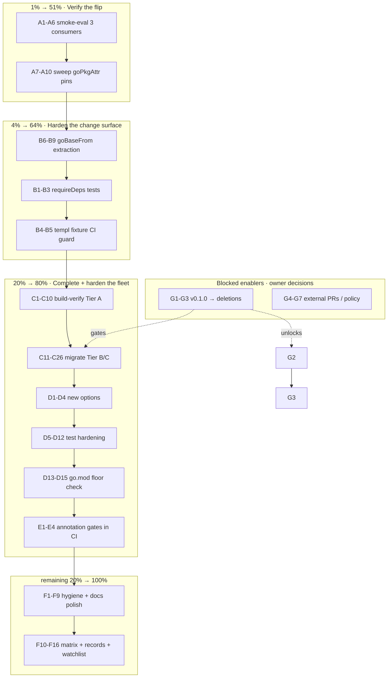

# Pareto Execution Plan — 2026-09-24 18:13

> **Scope:** ALL open TODOs from `TODO_LIST.md` (T1–T32, 5 Blocked, 1 rejected-on-merit) plus the
> deferred/external watchlist carried in the live status reports. Source snapshot: the
> 2026-09-24 docs-health audit (`docs/status/2026-09-24_18-06_docs-health-full-audit-annotate-archive.md`).
> **This plan ranks; `TODO_LIST.md` remains the living source.** New tasks surfaced by the audit
> were added there as T26–T32 before this plan was written.

---

## Context

go-nix-helpers is a Nix **library** consumed by 34 LarsArtmann Go repos (10 on the go-standard
module, ~22 legacy manual, 2 on deprecated `mkGoFlake`). The docs are now fully truthful (14
drifts repaired 2026-09-24; 23 old reports archived). The open work concentrates on four themes:

1. **The unverified default flip** — `goPkgAttr` auto-default shipped 2026-09-24 with ZERO
   consumer verification. Every consumer gets a toolchain jump (possible vendorHash mismatch) on
   next `flake.lock` update. Three separate reports call this the "biggest honest gap".
2. **The unfinished fleet migration** — 24/34 repos still on legacy patterns (audit's core
   finding). G2 unblocks all of Tier B/C.
3. **Coverage holes on shipped behavior** — `requireDeps` (zero tests), `goBase` (active split
   brain in the exact code the default flip touched), templ fixture (daemon already broke it once).
4. **Docs that still cannot rot-proof themselves** — hand-typed counts struck again this session;
   the annotation gates that saved the audit are session discipline, not CI.

**Non-goals:** re-implementing `buildGoModule`, non-Go projects, replacing flake-parts
(ROADMAP Non-goals). Do not verschlimmbessern: no speculative rewrites; every change leaves the
repo verifiably no worse.

---

## Pareto Breakdown

### The 1% that delivers 51% of the result

**Verify the shipped auto-default against the real fleet (T1 + T2).**
Why: the flake's entire value proposition is "consumers build reliably". The default flip is the
largest behavioral change in months, silently awaiting every consumer in their next lock update.
Proving 3 real consumers (eval + `nix build` + vendorHash intact) converts a triple-flagged
honest gap into evidence; sweeping the fleet's redundant `goPkgAttr` pins removes the confusion
the flip creates. ~105min total.

### The 4% that delivers 64% of the result

**Add the 1% + harden the change surface it just verified:**

- T6: `requireDeps` test assertions (option ships with zero coverage — verified by grep)
- T7: CI guard forbidding committed `*_templ.go` under the missing-generated fixture (the daemon
  re-added it once and turned moduleTest red — it WILL retry)
- T8: extract shared `goBase` resolution (active split brain: `modules/go-standard.nix:478` vs
  `mkGoFlake.nix:98` — the exact code T1 verifies)
  +90min cumulative.

### The 20% that delivers 80% of the result

**Complete and harden the fleet migration:**

- T3: build-verify the 10 eval-only Tier A migrations ("it evaluates" ≠ "it builds")
- T4 + T5: migrate Tier B (6 repos) and Tier C (2 repos) — closes the audit's core finding
- T13: `goExperiment`/`cgoEnabled`/`completionStyle` options (7/10 Tier A repos repeat
  GOEXPERIMENT boilerplate; cobra consumers need subcommand-style completions)
- T11/T12/T14/T15/T20/T21: test + UX hardening (throw-message assertion, ERE escaping,
  proxyVendor warning, templ in modBuildPhase, glob quoting, error-text assertion)
- T9/T10: `pkgs.go` fallback + mkGoFlake smoke coverage
- T16: eval-time go.mod floor check (converts the silent breaker class into an actionable error)
- T30 + T29: annotation gates as a flake check + exemption notes (make CI the drift-catcher)

### The remaining 20% (polish to reach 100%)

- T17–T19, T22, T23, T25: repo hygiene micro-fixes (symlinks, comments, warnings, patterns, dashboard)
- T26–T28: docs cosmetics from the audit (list-marker spacing, render-verify, groff check)
- T24: old-nixpkgs pinned matrix job
- T31/T32: records (0817f80 correction note, lock-bump postmortem)
- External/deferred watchlist: CV lock+vendorHash proof, SKILLS-repo follow-ups, x86_64-darwin
  warning root-cause, `passthru.go`, older-pin warning, flake-docs consolidation (dormant)
- Blocked enablers: v0.1.0 tag → mkGoFlake + template removal; maintainers nixpkgs PR; SSH CI
  test; df9a5ff fix; Won't-implement policy decision

---

## Comprehensive Plan (medium granularity — 30–100min tasks)

Sorted by importance / impact / effort / customer-value (fleet of 34 consumer repos = the customer).

| #                                                                                                                                                                                                                                                                         | Task                                                                                                                                                                    | Pareto tier | Impact       | Effort     | Covers                     |
| ------------------------------------------------------------------------------------------------------------------------------------------------------------------------------------------------------------------------------------------------------------------------- | ----------------------------------------------------------------------------------------------------------------------------------------------------------------------- | ----------- | ------------ | ---------- | -------------------------- |
| ~~P1~~ done — 3 consumers eval+build green, vendorHash intact (04-39 wrapup §a; CHANGELOG goPkgAttr fleet verification)                                                                                                                                                   | ~~Smoke-eval 3 real consumers (erraudit, PMA, go-auto-upgrade) against the auto default: `nix flake check --no-build` + `nix build` + vendorHash intact~~               | ~~**1%**~~  | ~~Critical~~ | ~~60min~~  | ~~T1~~                     |
| ~~P2~~ done — 14 repos' pins removed, all eval-verified (04-39 §a; CHANGELOG)                                                                                                                                                                                             | ~~Sweep consumer fleet for redundant `goPkgAttr = "go_1_26"` pins; remove pin + eval-verify per repo~~                                                                  | ~~**1%**~~  | ~~High~~     | ~~45min~~  | ~~T2~~                     |
| ~~P3~~ done — requireDeps coverage shipped (04-39 §a; CHANGELOG; moduleTest 123)                                                                                                                                                                                          | ~~`requireDeps` test assertions (default, dedup path, forwarding) in `test-module.nix`~~                                                                                | ~~**4%**~~  | ~~High~~     | ~~30min~~  | ~~T6~~                     |
| ~~P4~~ done — checks.templFixtureGuard shipped, verified red+green (04-39 §a; CHANGELOG)                                                                                                                                                                                  | ~~CI guard: fail when `*_templ.go` is committed under `test-assets/mock-templ-missing-generated/`~~                                                                     | ~~**4%**~~  | ~~High~~     | ~~30min~~  | ~~T7~~                     |
| ~~P5~~ done — pure-functions.goBaseFrom shipped (04-39 §a; CHANGELOG)                                                                                                                                                                                                     | ~~Extract `goBaseFrom` into `pure-functions.nix`; use from module + mkGoFlake; keep pureFunctions green~~                                                               | ~~**4%**~~  | ~~Med~~      | ~~30min~~  | ~~T8~~                     |
| ~~P6~~ done — Tier A 1–5 build-verified; 10/10 green (CHANGELOG; 06-30 report)                                                                                                                                                                                            | ~~Build-verify Tier A repos 1–5 (`nix build`, update vendorHash where the proxyVendor flip bites)~~                                                                     | ~~20%~~     | ~~High~~     | ~~90min~~  | ~~T3 (a)~~                 |
| ~~P7~~ done — Tier A 6–10 build-verified; 10/10 green (CHANGELOG)                                                                                                                                                                                                         | ~~Build-verify Tier A repos 6–10 (same protocol; commit per repo)~~                                                                                                     | ~~20%~~     | ~~High~~     | ~~90min~~  | ~~T3 (b)~~                 |
| ~~P8~~ done — T4 DONE 2026-11-18 (CHANGELOG [Unreleased] purge; KeyCountdown e1f0a5290)                                                                                                                                                                                   | ~~Migrate KeyCountdown + branching-flow to go-standard~~                                                                                                                | ~~20%~~     | ~~High~~     | ~~80min~~  | ~~T4 (a)~~                 |
| ~~P9~~ done — T4 DONE 2026-11-18 (CHANGELOG [Unreleased] purge)                                                                                                                                                                                                           | ~~Migrate StopTube + overview to go-standard (G2 per-package attrs in anger)~~                                                                                          | ~~20%~~     | ~~High~~     | ~~80min~~  | ~~T4 (b)~~                 |
| ~~P10~~ done — T4 DONE 2026-11-18 (CHANGELOG [Unreleased] purge; bank-sync also T50, BuildFlow 579a884a)                                                                                                                                                                  | ~~Migrate bank-sync (allowUnfree pattern) + BuildFlow (largest, 1215 lines)~~                                                                                           | ~~20%~~     | ~~High~~     | ~~100min~~ | ~~T4 (c)~~                 |
| ~~P11~~ done — T5 DONE 2026-11-18 (CHANGELOG [Unreleased] purge)                                                                                                                                                                                                          | ~~Migrate Standup-Killer off deprecated mkGoFlake~~                                                                                                                     | ~~20%~~     | ~~Med~~      | ~~60min~~  | ~~T5 (a)~~                 |
| ~~P12~~ done — T5 DONE 2026-11-18 (CHANGELOG [Unreleased] purge; mkGoFlake consumers = 0)                                                                                                                                                                                 | ~~Migrate crush-daily off mkGoFlake (NixOS module via perSystem)~~                                                                                                      | ~~20%~~     | ~~Med~~      | ~~60min~~  | ~~T5 (b)~~                 |
| ~~P13~~ done — options shipped (04-39 §a D1–D4; CHANGELOG; go-standard.nix:466–507)                                                                                                                                                                                       | ~~Add `goExperiment` (string), `cgoEnabled` (bool), `completionStyle` (enum) options + tests + docs~~                                                                   | ~~20%~~     | ~~High~~     | ~~90min~~  | ~~T13~~                    |
| ~~P14~~ done — D5/D6 shipped 2026-09-25 (04-39 §a); later rewritten message-free per the Nix 2.34 tryEval lesson (CHANGELOG 0.1.0)                                                                                                                                        | ~~Harden negative tests: templ-committed asserts throw MESSAGE + verifyValidation asserts error text~~                                                                  | ~~20%~~     | ~~Med~~      | ~~45min~~  | ~~T11+T21~~                |
| ~~P15~~ done — ERE escaping via escapeShellArg (mkPreparedSource.nix:321) + eval-time glob validation with adversarial test (04-39 §a; test-module.nix:887)                                                                                                               | ~~Escape ERE metachars in `publicDeps` grep + quote `excludeSubModuleDirs` case-glob inputs~~                                                                           | ~~20%~~     | ~~Med~~      | ~~30min~~  | ~~T12+T20~~                |
| ~~P16~~ done — split: proxyVendor warning shipped (go-standard.nix:1159; 04-39 §a D9); the templ-in-modBuildPhase half is deferred — TODO_LIST.md Blocked T15                                                                                                             | ~~`proxyVendor` forced-false trace warning + `templ generate` in modBuildPhase when enableTempl~~                                                                       | ~~20%~~     | ~~Med~~      | ~~45min~~  | ~~T14+T15~~                |
| ~~P17~~ done — pkgs.go fallback in goBaseFrom stub tests + mkGoFlake eval smoke (04-39 §a D11/D12)                                                                                                                                                                        | ~~`pkgs.go` fallback branch test + mkGoFlake eval smoke check~~                                                                                                         | ~~20%~~     | ~~Med~~      | ~~45min~~  | ~~T9+T10~~                 |
| ~~P18~~ done — floor check shipped, tested, documented (04-39 §a D13–D15; CHANGELOG goModFloorMessage)                                                                                                                                                                    | ~~Eval-time go.mod floor check: read consumer go.mod, warn/throw when resolved toolchain < floor~~                                                                      | ~~20%~~     | ~~High~~     | ~~90min~~  | ~~T16~~                    |
| ~~P19~~ done — checks.docsAnnotations + exemption notes (04-39 §f.18–21; CHANGELOG)                                                                                                                                                                                       | ~~Vendor check-rows + grep-gate into `scripts/`, wire as flake check; add exemption notes to 07-38/06-51~~                                                              | ~~20%~~     | ~~Med~~      | ~~90min~~  | ~~T30+T29~~                |
| ~~P20~~ done — render-verify + groff done (04-39 §f.23–24); corpus clean — zero double-tilde-prefixed markers remain in docs/status (grep-verified 2026-11-19)                                                                                                            | ~~Docs polish: `1.~~`→`1. ~~` corpus pass + render-verify 5 largest tables + groff-check man pages~~                                                                    | ~~rest~~    | ~~Low~~      | ~~45min~~  | ~~T26+T27+T28~~            |
| ~~P21~~ done — F4–F9 all shipped (04-39 §f.25–29; verified in source: mkPreparedSource.nix:12/259, nix-lint.sh:113, dashboard.sh:33)                                                                                                                                      | ~~Hygiene sweep: trash result* symlinks + gitignore, mindepth comment, "any depth" comment, `__intentionallyOverridingVersion`, nix-lint go_1_XX, dashboard GO_LATEST~~ | ~~rest~~    | ~~Low~~      | ~~60min~~  | ~~T17–T19, T22, T23, T25~~ |
| ~~P22~~ done — old-nixpkgs CI job live and green (e94f290; CHANGELOG)                                                                                                                                                                                                     | ~~Old-nixpkgs pinned CI matrix job for moduleTest (graceful degradation proof)~~                                                                                        | ~~rest~~    | ~~Med~~      | ~~60min~~  | ~~T24~~                    |
| ~~P23~~ done — corrections + postmortem docs shipped (04-39 §f.31–32; files exist under docs/corrections/ + docs/postmortems/)                                                                                                                                            | ~~Records: 0817f80 mechanism correction note + lock-bump postmortem doc~~                                                                                               | ~~rest~~    | ~~Low~~      | ~~45min~~  | ~~T31+T32~~                |
| ~~P24~~ done — 4 of 5 resolved (CV 2026-11-17, darwin root-cause, passthru.go, stale-pin warning; 04-39 §f.33–36); flake-docs consolidation never decided (dormant)                                                                                                       | ~~External watchlist triage: CV lock+vendorHash proof, x86_64-darwin warning root-cause, passthru.go, older-pin warning, flake-docs consolidation decision~~            | ~~rest~~    | ~~Low~~      | ~~60min~~  | ~~live-report items~~      |
| ~~P25~~ done — v0.1.0 tagged ad06738 2026-11-18 (CHANGELOG 0.1.0); mkGoFlake + template deleted at 9c8724b (CHANGELOG Unreleased)                                                                                                                                         | ~~v0.1.0 release cut (after owner decision): CHANGELOG cut, tag, push, verify proxy/pkg.go.dev; then delete mkGoFlake + go-flake-parts template~~                       | ~~rest~~    | ~~High~~     | ~~90min~~  | ~~Blocked→T~~              |
| P26 **→ decided: defer — routed TODO_LIST.md Blocked: nixpkgs maintainer PR + SSH CI secret + df9a5ff rebase rows ("Requires external PR to nixpkgs repo" / "needs SSH key secret (DEPLOY_SSH_KEY)" / "Requires interactive rebase + force-push; user approval needed")** | Blocked enablers: maintainers.larsartmann nixpkgs PR, enable SSH CI test (needs DEPLOY_SSH_KEY), df9a5ff rebase fix                                                     | rest        | Med          | 90min      | Blocked                    |

**26 tasks · ~17.5h total.** P1–P5 (the 4%) = 195min for ~64% of the value.

---

## Detailed Breakdown (fine granularity — ≤12min tasks)

Every medium task decomposed into atomic steps. Sorted within workstream by execution order;
workstreams ordered by Pareto tier. IDs encode parent (P1.1 = step 1 of P1).

### Workstream A — Verify the flip (1% → 51%)

| ID                                                                              | Task (each ≤12min)                                                                                           | Est     |
| ------------------------------------------------------------------------------- | ------------------------------------------------------------------------------------------------------------ | ------- |
| ~~A1~~ done — erraudit/PMA/go-auto-upgrade verified 2026-09-25 (04-39 §a A1–A6) | ~~erraudit: `nix flake check --no-build` with updated go-nix-helpers; record result~~                        | ~~10m~~ |
| ~~A2~~ done — erraudit/PMA/go-auto-upgrade verified 2026-09-25 (04-39 §a A1–A6) | ~~erraudit: `nix build`; if vendorHash mismatch → `buildflow -s nix-hash-fix --fix`, rebuild, record~~       | ~~12m~~ |
| ~~A3~~ done — erraudit/PMA/go-auto-upgrade verified 2026-09-25 (04-39 §a A1–A6) | ~~PMA: `nix flake check --no-build` (requireDeps consumer — proves the option resolves from remote master)~~ | ~~10m~~ |
| ~~A4~~ done — erraudit/PMA/go-auto-upgrade verified 2026-09-25 (04-39 §a A1–A6) | ~~PMA: `nix build` + vendorHash check/fix~~                                                                  | ~~12m~~ |
| ~~A5~~ done — erraudit/PMA/go-auto-upgrade verified 2026-09-25 (04-39 §a A1–A6) | ~~go-auto-upgrade: `nix flake check --no-build` (largest migrated flake, 374 lines)~~                        | ~~10m~~ |
| ~~A6~~ done — erraudit/PMA/go-auto-upgrade verified 2026-09-25 (04-39 §a A1–A6) | ~~go-auto-upgrade: `nix build` + vendorHash check/fix~~                                                      | ~~12m~~ |
| ~~A7~~ done — pin inventory built; 14 repos swept 2026-09-25 (04-39 §a A7–A10)  | ~~`grep -rn 'goPkgAttr' /home/lars/projects/*/flake.nix` — build the pin inventory~~                         | ~~10m~~ |
| ~~A8~~ done — pins removed, eval-verified (04-39 §a A7–A10)                     | ~~Remove pins from repos 1–4 of inventory; eval-verify each (`--no-build`)~~                                 | ~~12m~~ |
| ~~A9~~ done — pins removed, eval-verified (04-39 §a A7–A10)                     | ~~Remove pins from repos 5–8; eval-verify each~~                                                             | ~~12m~~ |
| ~~A10~~ done — sweep recorded (04-39 §a; CHANGELOG "14 repos")                  | ~~Remove pins from remaining repos; eval-verify; record sweep result in TODO_LIST T2 evidence~~              | ~~12m~~ |

### Workstream B — Harden the change surface (4% → 64%)

| ID                                                  | Task                                                                                                               | Est     |
| --------------------------------------------------- | ------------------------------------------------------------------------------------------------------------------ | ------- |
| ~~B1~~ done — shipped 2026-09-25 (04-39 §a B1–B3)   | ~~test-module.nix: assert `requireDeps` default `{}`~~                                                             | ~~8m~~  |
| ~~B2~~ done — shipped 2026-09-25 (04-39 §a B1–B3)   | ~~test-module.nix: assert requireDeps entries reach mkPreparedSource postPatch (grep passthru/postPatch)~~         | ~~12m~~ |
| ~~B3~~ done — shipped 2026-09-25 (04-39 §a B1–B3)   | ~~test.nix: assert dedup against existing requires (already covered — extend with a duplicate-entry case)~~        | ~~12m~~ |
| B4 **→ done — shipped 2026-09-25 (04-39 §a B4–B5)** | flake.nix: add `templ-fixture-guard` check (`git ls-files \| grep mock-templ-missing-generated.*_templ.go` → fail) |         |
| ~~B5~~ done — shipped 2026-09-25 (04-39 §a B4–B5)   | ~~Verify guard passes green; deliberately stage a fixture file, verify it fails, unstage~~                         | ~~12m~~ |
| ~~B6~~ done — shipped 2026-09-25 (04-39 §a B6–B9)   | ~~pure-functions.nix: extract `goBaseFrom { pkgs lib goPkgAttr goPkgOverride goTarballVersion goTarballHash }`~~   | ~~12m~~ |
| ~~B7~~ done — shipped 2026-09-25 (04-39 §a B6–B9)   | ~~modules/go-standard.nix: replace inline goBase block with the helper; moduleTest green~~                         | ~~12m~~ |
| ~~B8~~ done — shipped 2026-09-25 (04-39 §a B6–B9)   | ~~mkGoFlake.nix: same replacement; eval smoke (mkGoFlake on mock config) green~~                                   | ~~12m~~ |
| ~~B9~~ done — shipped 2026-09-25 (04-39 §a B6–B9)   | ~~pureFunctions: add goBaseFrom assertions (pin wins / auto newest / pkgs.go fallback / tarball precedence)~~      | ~~12m~~ |

### Workstream C — Fleet build-verification + migration (20% → 80%)

| ID                                                                                                      | Task                                                                                                             | Est     |
| ------------------------------------------------------------------------------------------------------- | ---------------------------------------------------------------------------------------------------------------- | ------- |
| ~~C1~~ done — Tier A build-verified 10/10 green (06-30 report; CHANGELOG)                               | ~~go-localsync: `nix build` + vendorHash fix if needed + commit~~                                                | ~~12m~~ |
| ~~C2~~ done — Tier A build-verified 10/10 green (06-30 report; CHANGELOG)                               | ~~erraudit: build (if not already from A2) + commit~~                                                            | ~~5m~~  |
| ~~C3~~ done — Tier A build-verified 10/10 green (06-30 report; CHANGELOG)                               | ~~project-meta: build + vendorHash fix (subModules consumer)~~                                                   | ~~12m~~ |
| ~~C4~~ done — Tier A build-verified 10/10 green (06-30 report; CHANGELOG)                               | ~~oxlint-auto-configure: build (wrapped app) + fix~~                                                             | ~~12m~~ |
| ~~C5~~ done — Tier A build-verified 10/10 green (06-30 report; CHANGELOG)                               | ~~project-dependency-graph: build + fix~~                                                                        | ~~12m~~ |
| ~~C6~~ done — Tier A build-verified 10/10 green (06-30 report; CHANGELOG)                               | ~~golangci-lint-auto-configure: build + fix~~                                                                    | ~~12m~~ |
| ~~C7~~ done — Tier A build-verified 10/10 green (06-30 report; CHANGELOG)                               | ~~go-humanize-linter: build (8 custom apps) + fix~~                                                              | ~~12m~~ |
| ~~C8~~ done — Tier A build-verified 10/10 green (06-30 report; CHANGELOG)                               | ~~standard-bug-tracking-schema: build (templ + treefmt overlay) + fix~~                                          | ~~12m~~ |
| ~~C9~~ done — Tier A build-verified 10/10 green (06-30 report; CHANGELOG)                               | ~~go-auto-upgrade: build (if not already from A6) + commit~~                                                     | ~~5m~~  |
| ~~C10~~ done — Tier A build-verified 10/10 green (06-30 report; CHANGELOG)                              | ~~Record Tier A build-verification matrix (10/10) in TODO_LIST T3 evidence; note any repo that needs follow-up~~ | ~~10m~~ |
| ~~C11~~ done — T4 DONE 2026-11-18 (CHANGELOG [Unreleased] purge; KeyCountdown e1f0a5290)                | ~~KeyCountdown: rewrite flake.nix to go-standard; `--no-build` verify~~                                          | ~~12m~~ |
| ~~C12~~ done — T4 DONE 2026-11-18 (CHANGELOG [Unreleased] purge)                                        | ~~KeyCountdown: `nix build` + vendorHash + commit~~                                                              | ~~12m~~ |
| ~~C13~~ done — T4 DONE 2026-11-18 (CHANGELOG [Unreleased] purge)                                        | ~~branching-flow: migrate (go-enum tool via extraBuildAttrs) + verify~~                                          | ~~12m~~ |
| ~~C14~~ done — T4 DONE 2026-11-18 (CHANGELOG [Unreleased] purge)                                        | ~~branching-flow: build + commit~~                                                                               | ~~12m~~ |
| ~~C15~~ done — T4 DONE 2026-11-18 (CHANGELOG [Unreleased] purge)                                        | ~~StopTube: migrate using G2 per-package extraBuildAttrs + verify~~                                              | ~~12m~~ |
| ~~C16~~ done — T4 DONE 2026-11-18 (CHANGELOG [Unreleased] purge)                                        | ~~StopTube: build + commit~~                                                                                     | ~~12m~~ |
| ~~C17~~ done — T4 DONE 2026-11-18 (CHANGELOG [Unreleased] purge)                                        | ~~overview: migrate (git-hooks input stays consumer-side) + verify~~                                             | ~~12m~~ |
| ~~C18~~ done — T4 DONE 2026-11-18 (CHANGELOG [Unreleased] purge)                                        | ~~overview: build (nixosModules preserved via perSystem) + commit~~                                              | ~~12m~~ |
| ~~C19~~ done — T4 DONE 2026-11-18 (CHANGELOG [Unreleased] purge)                                        | ~~bank-sync: migrate (allowUnfree via nixpkgs.config consumer-side or module option) + verify~~                  | ~~12m~~ |
| ~~C20~~ done — T4 DONE 2026-11-18 (CHANGELOG [Unreleased] purge)                                        | ~~bank-sync: build + commit~~                                                                                    | ~~12m~~ |
| ~~C21~~ done — T4 DONE 2026-11-18 (CHANGELOG [Unreleased] purge; BuildFlow 579a884a)                    | ~~BuildFlow: migrate part 1 — inputs + go-standard config skeleton~~                                             | ~~12m~~ |
| ~~C22~~ done — T4 DONE 2026-11-18 (CHANGELOG [Unreleased] purge; BuildFlow 579a884a)                    | ~~BuildFlow: migrate part 2 — multi-tool packages via G2 + custom apps~~                                         | ~~12m~~ |
| ~~C23~~ done — T4 DONE 2026-11-18 (CHANGELOG [Unreleased] purge; BuildFlow 579a884a)                    | ~~BuildFlow: eval + build + vendorHash + commit~~                                                                | ~~12m~~ |
| ~~C24~~ done — T4 DONE 2026-11-18 (CHANGELOG [Unreleased] purge)                                        | ~~Standup-Killer: migrate off mkGoFlake (subModules + doCheck=false) + verify + build + commit~~                 | ~~12m~~ |
| ~~C25~~ done — T4 DONE 2026-11-18 (CHANGELOG [Unreleased] purge; T5 evidence: mkGoFlake zero consumers) | ~~crush-daily: migrate (NixOS module via perSystem flake attr) + verify~~                                        | ~~12m~~ |
| ~~C26~~ done — T4 DONE 2026-11-18 (CHANGELOG [Unreleased] purge)                                        | ~~crush-daily: build + commit; mark T5 done — deprecated path has ZERO consumers~~                               | ~~12m~~ |

### Workstream D — Module options + hardening (20% → 80%)

| ID                                                                                                                                                                                   | Task                                                                                                          | Est     |
| ------------------------------------------------------------------------------------------------------------------------------------------------------------------------------------ | ------------------------------------------------------------------------------------------------------------- | ------- |
| ~~D1~~ done — shipped 2026-09-25 (04-39 §a D1–D4)                                                                                                                                    | ~~`goExperiment` option (nullOr str → build env + shellExtraEnv) + description~~                              | ~~12m~~ |
| ~~D2~~ done — shipped 2026-09-25 (04-39 §a D1–D4)                                                                                                                                    | ~~`cgoEnabled` option (nullOr bool → env.CGO_ENABLED) + description~~                                         | ~~12m~~ |
| ~~D3~~ done — shipped 2026-09-25 (04-39 §a D1–D4)                                                                                                                                    | ~~`completionStyle` option (enum flag/subcommand) + enableCompletions branches on it~~                        | ~~12m~~ |
| ~~D4~~ done — shipped 2026-09-25 (04-39 §a D1–D4)                                                                                                                                    | ~~Tests for all three options (defaults + propagation) + man page + README rows + CHANGELOG~~                 | ~~12m~~ |
| ~~D5~~ done — shipped 2026-09-25 (04-39 §a D5); later rewritten message-free (Nix 2.34, CHANGELOG 0.1.0)                                                                             | ~~templ-committed negative test: assert throw message contains "committed *_templ.go"~~                       | ~~12m~~ |
| ~~D6~~ done — shipped 2026-09-25 (04-39 §a D6 + §f.4: verifyValidation PASS after host fix)                                                                                          | ~~verifyValidation: assert error text names the missing module (extend script + expected-output check)~~      | ~~12m~~ |
| D7 **→ done — shipped 2026-09-25 (04-39 §a D7; escapeShellArg at mkPreparedSource.nix:321)**                                                                                         | publicDeps: escape ERE metachars (`sed 's/[.[\*^$()+?{\|]/\\&/g'`) before grep -vE; Test 7 still green        |         |
| ~~D8~~ done — shipped 2026-09-25 (04-39 §a D8; eval-time validation, test-module.nix:887/1521)                                                                                       | ~~excludeSubModuleDirs: validate/quote entries spliced into the case glob; add adversarial test~~             | ~~12m~~ |
| ~~D9~~ done — shipped 2026-09-25 (04-39 §a D9; proxyVendorWarning go-standard.nix:1159)                                                                                              | ~~proxyVendor: emit builtins.trace when deps force it false and consumer set true~~                           | ~~10m~~ |
| D10 **→ decided: defer — routed TODO_LIST.md Blocked: "T15: templ generate in modBuildPhase when enableTempl — Owner decision pending (2026-09-25 §g.3: propose won't-implement…)"** | enableTempl: add `templ generate` to modBuildPhase (FOD) — standard-bug-tracking-schema can drop its override | 12m     |
| ~~D11~~ done — shipped 2026-09-25 (04-39 §a D11; goBaseFrom property tests with stub pkgs)                                                                                           | ~~test: pkgs.go fallback (stub pkgs attrset without go_1_XX) in pureFunctions/goBaseFrom tests~~              | ~~12m~~ |
| ~~D12~~ done — shipped 2026-09-25 (04-39 §a D12; treefmt-nix-stubbed smoke; block later removed with mkGoFlake)                                                                      | ~~mkGoFlake eval smoke: minimal config through flake.lib.mkGoFlake in test.nix~~                              | ~~12m~~ |
| ~~D13~~ done — shipped 2026-09-25 (04-39 §a D13)                                                                                                                                     | ~~go.mod floor check: parse `self/go.mod` go directive at eval (builtins.readFile, no IFD)~~                  | ~~12m~~ |
| ~~D14~~ done — shipped 2026-09-25 (04-39 §a D14)                                                                                                                                     | ~~go.mod floor check: compare vs resolved toolchain version; throw actionable error (or warn) + tests~~       | ~~12m~~ |
| ~~D15~~ done — shipped 2026-09-25 (04-39 §a D15)                                                                                                                                     | ~~go.mod floor check: docs (man page + README FAQ "my go.mod is newer than nixpkgs") + CHANGELOG~~            | ~~12m~~ |

### Workstream E — CI-enforced truthfulness (20% → 80%)

| ID                                                                                                      | Task                                                                                                           | Est     |
| ------------------------------------------------------------------------------------------------------- | -------------------------------------------------------------------------------------------------------------- | ------- |
| ~~E1~~ done — vendored check-rows.py + gate, 2026-09-25 (04-39 §f.18; CHANGELOG checks.docsAnnotations) | ~~Vendor `check-rows.py` + a grep-gate wrapper into `scripts/` (attribution comment to docs-health skill)~~    | ~~12m~~ |
| ~~E2~~ done — green in full check + CI (04-39 §f.19)                                                    | ~~flake.nix: `checks.docs-annotations` running both gates over `docs/status/`; green~~                         | ~~12m~~ |
| ~~E3~~ done — guard-the-guard red on planted defects (04-39 §f.20; derivation-level re-proof via T65)   | ~~Deliberately un-strike one row → verify red → restore (guard the guard)~~                                    | ~~12m~~ |
| ~~E4~~ done — exemption notes added (04-39 §f.21)                                                       | ~~Exemption notes: 07-38 §B + 06-51 "What went well" get one-line "informational — intentionally bare" notes~~ | ~~10m~~ |

### Workstream F — Polish + records (remaining 20% → 100%)

| ID                                                                                                                                  | Task                                                                                                   | Est     |
| ----------------------------------------------------------------------------------------------------------------------------------- | ------------------------------------------------------------------------------------------------------ | ------- |
| ~~F1~~ done — zero double-tilde-prefixed markers remain in docs/status (grep-verified 2026-11-19)                                   | ~~Corpus regex pass `^(\s*\d+)\.~~` → `$1. ~~` over docs/status; spot-check diff~~                     | ~~12m~~ |
| ~~F2~~ done — glow render pass (04-39 §f.23); pandoc <del> proof via T65 (117 del elements)                                         | ~~Render-verify 5 largest struck tables (glow/markdown-preview); fix any broken shapes~~               | ~~12m~~ |
| ~~F3~~ done — man render clean (04-39 §f.24)                                                                                        | ~~`MANWIDTH=80 man --local-file docs/man/go-standard.5` + mkPreparedSource.5; fix any groff warnings~~ | ~~5m~~  |
| ~~F4~~ done — trashed + gitignored (04-39 §f.25)                                                                                    | ~~`trash result result-1 result-2 result-3 result-auto result-verify result-vv`; gitignore `result*`~~ | ~~5m~~  |
| ~~F5~~ done — comment present (mkPreparedSource.nix:259–261)                                                                        | ~~autoDiscoverScript: comment/named variable for `-mindepth 3` root-skip~~                             | ~~10m~~ |
| ~~F6~~ done — header comment fixed (mkPreparedSource.nix:12, 62)                                                                    | ~~autoDiscoverScript: fix "ALL go.mod at any depth" header comment (top-level skipped by design)~~     | ~~5m~~  |
| ~~F7~~ done — markers set; re-verified 2026-11-17 (04-39 §f.27; T65 23.3)                                                           | ~~goPkgOverride test: set `__intentionallyOverridingVersion` (silence nixpkgs warning noise)~~         | ~~10m~~ |
| ~~F8~~ done — generalized (04-39 §f.28; scripts/nix-lint.sh:111–114)                                                                | ~~nix-lint.sh: generalize `go_1_26-outline` message patterns to `go_1_XX-outline`~~                    | ~~10m~~ |
| ~~F9~~ done — lib.newestGoAttr wired (04-39 §f.29; scripts/dashboard.sh:30–33; CHANGELOG)                                           | ~~dashboard.sh: derive GO_LATEST from nixpkgs attrNames (kill last manual-bump site)~~                 | ~~12m~~ |
| ~~F10~~ done — job live + green on both pins (04-39 §f.30; e94f290)                                                                 | ~~CI: old-nixpkgs pinned matrix job (nixpkgs ref override, moduleTest only)~~                          | ~~12m~~ |
| ~~F11~~ done — docs/corrections/2026-09-07_0817f80-interpolation-mechanism.md (04-39 §f.31)                                         | ~~docs/corrections: 0817f80 mechanism note (indented-string interpolation, not "regex mismatch")~~     | ~~12m~~ |
| ~~F12~~ done — docs/postmortems/2026-09-25_lock-bump-and-silent-host-break.md (04-39 §f.32)                                         | ~~docs/postmortems: lock-bump eval-break case study ("input bumps are eval changes")~~                 | ~~12m~~ |
| ~~F13~~ done — CV premise resolved: lock consumes go-nix-helpers at the ADR-0003 canon rev, builds green (04-39 §f.33; T65 item 24) | ~~Watchlist: CV `nix flake lock update` + FOD build proof (coordinate with CV repo)~~                  | ~~12m~~ |
| ~~F14~~ done — systems default drops x86_64-darwin + option wired; warning gone (04-39 §f.34; CHANGELOG 0.1.0)                      | ~~Watchlist: root-cause x86_64-darwin "incompatible system" warning in flake check output~~            | ~~12m~~ |
| ~~F15~~ done — passthru.go shipped explicitly (04-39 §f.35; e886424; CHANGELOG)                                                     | ~~Watchlist: `passthru.go` on default package; verify all outputs expose resolved toolchain~~          | ~~12m~~ |
| ~~F16~~ done — staleGoAttrName + 6 property tests (04-39 §f.36; e94f290; CHANGELOG)                                                 | ~~Watchlist: warn when goPkgAttr pins older than nixpkgs newest~~                                      | ~~12m~~ |

### Workstream G — Blocked enablers (after owner decisions)

| ID                                                                                                                                                                         | Task                                                                                           | Est     |
| -------------------------------------------------------------------------------------------------------------------------------------------------------------------------- | ---------------------------------------------------------------------------------------------- | ------- |
| ~~G1~~ done — v0.1.0 tagged ad06738 2026-11-18, GitHub release published, tag verified consumer-style (CHANGELOG 0.1.0)                                                    | ~~v0.1.0: verify suite green, cut CHANGELOG section, annotated tag, push, watch module proxy~~ | ~~12m~~ |
| ~~G2~~ done — mkGoFlake deleted at 9c8724b (CHANGELOG Unreleased Removed)                                                                                                  | ~~Post-tag: delete `mkGoFlake.nix` + trace wrapper + structural-check reference update~~       | ~~12m~~ |
| ~~G3~~ done — templates/go-flake-parts deleted at 9c8724b (CHANGELOG Unreleased Removed)                                                                                   | ~~Post-tag: delete `templates/go-flake-parts/` + README/generate-flake.sh references~~         | ~~12m~~ |
| G4 **→ decided: defer — routed TODO_LIST.md Blocked: "Register maintainers.larsartmann in nixpkgs — Requires external PR to nixpkgs repo"**                                | maintainers.larsartmann: nixpkgs PR (maintainer-list.nix entry) — external                     | 12m     |
| G5 **→ decided: defer — routed TODO_LIST.md Blocked: "Real private-repo integration test in CI — CI job scaffolded (if: false); needs SSH key secret (DEPLOY_SSH_KEY)"**   | SSH CI test: add DEPLOY_SSH_KEY secret, flip `if: false`, verify green                         | 12m     |
| G6 **→ decided: defer — routed TODO_LIST.md Blocked: "Fix empty commit message in df9a5ff — Requires interactive rebase + force-push; user approval needed"**              | df9a5ff: interactive rebase to amend empty message + force-with-lease (approval already asked) | 12m     |
| G7 **→ decided: defer — routed TODO_LIST.md Blocked: "Decide the Won't-implement policy (age threshold / cap / owner sign-off for 'dormant — dropped') — Owner decision"** | Won't-implement policy: record owner decision in AGENTS.md docs conventions section            | 10m     |

**67 fine tasks · ~11h of atomic work (the 26 medium tasks carry the remaining overhead).**

---

## Execution Graph (mermaid)

Execution order rationale: verify before extending (T1/T2 prove the surface), harden what
verification touched (T6–T8), then migrate the fleet against a proven module, then make CI the
permanent gatekeeper, then polish. The v0.1.0 decision gates only the deletions (G2/G3) — nothing
else waits on it.

---

## Verification protocol (every task)

1. `nix flake check` green (or `--no-build` for consumer repos) after each change
2. `nix fmt` clean
3. Consumer tasks: eval-verify AND build-verify; commit per repo only after both
4. Docs tasks: the changed doc's claims re-derived from tool output, not arithmetic
5. No Verschlimmbesserung check: does the change reduce, not add, moving parts?

---

_Point-in-time snapshot · 2026-09-24 18:13 · living source: `TODO_LIST.md` · harvest/annotate via docs-health skill_
