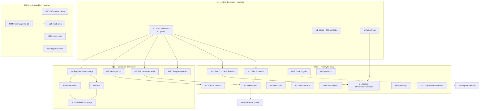

# Pareto Plan: Green Master → Fleet Value (post corpus-sweep)

**Created:** 2026-11-17 21:17 CET · **Repo state:** clean at `4594a9a`, 3 commits ahead of origin · **Authoritative living source:** `TODO_LIST.md` (T4–T71 + Blocked register); this plan ranks, it does not replace.

**Context (why the plan looks like this):** the docs corpus is fully truthful (2026-11-17 sweep: ~500 verdicts, 11 reports archived, battery 5/5 green, counts re-derived: 54 options / 17 container keys / 218 moduleTest / 72 pureFunctions). The OCI `container` option is built, tested, and **CI-green on origin through `6f5a76f`** (run 44164948028 — first green master since ≥2026-10-30). What remains is conversion work: turn a green, documented library into fleet-wide value — consumers shipping images on it, the deprecated paths deleted, and the verification gaps closed mechanically. The "customer" here is Lars + 34 consumer repos.

---

## Step 0 — Errata (verified while ranking; corrections on the record)

1. **The push question is 70% answered by events**: an external actor pushed through `6f5a76f` (CI green, 21:02 CET). What remains is pushing the last 3 commits (formatter-damage repair `ad0f44a` + status report `4594a9a` + the daemon's sweep of this plan). The plan's 1% tier shrinks accordingly — it was "push 10 + watch"; now "push 3 + watch".
2. **T47's premise refreshed**: origin carries the container option, so the PapDashboard relock is a plain `nix flake lock --update-input go-nix-helpers` — no path-override lane needed at merge time.
3. **T52/T57 evidence wording** ("daemon pushed master") was corrected 2026-11-17 to "push happened, actor unknown; daemon commits only" — no task content changed.
4. **18-52 f/9 (README OCI audit) is DONE** (docs-health VERIFY pass, 2026-11-17) — it never had a T-row; noted so no future harvest re-creates it.
5. **T65's F7 sub-item is done** (warning absent from moduleTest log, re-verified 2026-11-17) — the P23 leg shrinks to derivation-red proof + pandoc render.

---

## Step 1 — Pareto Breakdown

### The 1% that delivers 51%: **Ship the green + settle the three verdicts**

| #                                                                                                                  | Task                                                                | Why it is the 1%                                                                                                                                      |
| ------------------------------------------------------------------------------------------------------------------ | ------------------------------------------------------------------- | ----------------------------------------------------------------------------------------------------------------------------------------------------- |
| ~~1~~ done — pushed; first fully green CI run 44152413584 (2026-11-17; 04-39 §f.48)                                | ~~Push the 3 remaining commits; watch CI stay green~~               | ~~Closes the red-origin window for good; makes the corpus sweep + container option public; every fleet migration is gated on it~~                     |
| 2 **→ decided: defer — routed TODO_LIST.md Blocked: Won't-implement policy row + T15 row (both "Owner decision")** | Owner verdict batch: Won't-implement policy + T15 (templ-in-builds) | Two 15-min decisions that unblock the annotation canon (~210 unilateral verdicts pending ratification) and clear a BLOCKED row carried for 3 sessions |
| ~~3~~ done — approved + cut: v0.1.0 tagged ad06738 2026-11-18 (release row graduated into CHANGELOG)               | ~~v0.1.0 tag decision (+ cut if approved)~~                         | ~~Unlocks mkGoFlake removal, template deletion, and consumer version pinning — the entire G-series unblocks on this one yes/no~~                      |

### The 4% that delivers 64%: **The container pilot wave + fleet audit**

| #                                                                                                    | Task                                                                            | Why                                                                                |
| ---------------------------------------------------------------------------------------------------- | ------------------------------------------------------------------------------- | ---------------------------------------------------------------------------------- |
| ~~4~~ done — T47 DONE 2026-11-17 (CHANGELOG [Unreleased] purge; merged 9af7bd7, relocked e8bc6e2)    | ~~T47 PapDashboard pilot merge (branch verified, relock now trivial)~~          | ~~The first fleet image shipped on the option; converts "tested" into "deployed"~~ |
| ~~5~~ done — T48 + T49 DONE (CHANGELOG [Unreleased] purge; KeyHolderAI 2026-11-17/18, sbts 91289661) | ~~T48 KeyHolderAI + T49 standard-bug-tracking-schema migrations~~               | ~~Two mechanical 2h migrations; every one deletes a hand-rolled image block~~      |
| ~~6~~ done — T50 DONE 2026-11-18 (CHANGELOG [Unreleased] purge; full battery green)                  | ~~T50 bank-sync go-standard adoption~~                                          | ~~Largest remaining manual consumer; the pattern proof for Tier B~~                |
| ~~7~~ done — T57 DONE 2026-11-18 (CHANGELOG [Unreleased] purge; 29 consumers relocked to 52dc6f8)    | ~~T57 post-push consumer audit (`nix flake update` sweeps)~~                    | ~~Verifies nix2container lands transitively without breakage across the fleet~~    |
| ~~8~~ done — T34 DONE 2026-11-18 (CHANGELOG [Unreleased] purge)                                      | ~~T34 option sweep (GOEXPERIMENT → `goExperiment`, cobra → `completionStyle`)~~ | ~~Deletes the most-repeated consumer boilerplate (7/10 Tier A repos)~~             |

### The 20% that delivers 80%: **Finish the migration + hardening story**

| #                                                                                                                         | Task                                                                                                                                                                                                                                | Why                                                                                                                     |
| ------------------------------------------------------------------------------------------------------------------------- | ----------------------------------------------------------------------------------------------------------------------------------------------------------------------------------------------------------------------------------- | ----------------------------------------------------------------------------------------------------------------------- |
| ~~9~~ done — T4 + T5 DONE 2026-11-18 (CHANGELOG [Unreleased] purge; mkGoFlake zero consumers)                             | ~~T4 Tier B migrations (6 repos) + T5 Tier C (2 repos) → mkGoFlake at ZERO consumers~~                                                                                                                                              | ~~Ends the two-pattern era; makes the deletion contract enforceable~~                                                   |
| ~~10~~ done — deleted at 9c8724b (CHANGELOG Unreleased Removed)                                                           | ~~G2+G3: delete `mkGoFlake.nix` + `templates/go-flake-parts` (post-tag)~~                                                                                                                                                           | ~~Removes deprecated surface + the last stale `go_1_26` reference~~                                                     |
| ~~11~~ done — T64 DONE (CHANGELOG [Unreleased] purge)                                                                     | ~~T64 self-host: this repo's flake on `flakeModules.go-standard`~~                                                                                                                                                                  | ~~The dogfood gap that let a dead `systems` option and missing `passthru.go` survive; makes the module self-verifying~~ |
| ~~12~~ done — T56 DONE (CHANGELOG [Unreleased] purge; scripts/ci-parity.sh exists, all green incl. nixpkgs 11-17 refresh) | ~~T56 ci-parity gate (shellcheck + `--all-systems --no-build` locally) + wire strict/bare-rows into the repo gate~~                                                                                                                 | ~~The 2026-11-17 shfmt re-drift shipped because no local gate exists; closes the CI-vs-local gap mechanically~~         |
| ~~13~~ done — T35/T37/T44/T45/T46/T53/T58/T59 all DONE (CHANGELOG [Unreleased] purge container rows)                      | ~~Container docs wave (T35 patterns, T37 checklist section, T44 tag docs, T45 registry auth, T46 workflow template, T53 skill note, T58 pin note, T59 tryEval pattern)~~                                                            | ~~The adoption surface: docs are what consumers copy~~                                                                  |
| ~~14~~ done — T60 DONE 2026-11-18 rounds 6+7 (CHANGELOG [Unreleased] purge; 31 consumers triaged, 3 builds repaired)      | ~~T60 fleet audit re-run (auto-default + container checklist)~~                                                                                                                                                                     | ~~One pass produces the next migration queue for free~~                                                                 |
| ~~15~~ done — T65 DONE (CHANGELOG [Unreleased] purge; every P21–P26 sub-item evidenced)                                   | ~~T65 polish batch P21–P26 (vendored-from marker, docs-gate extension, nix-health dirty-warn, derivation-red proof, pandoc render, assertion-count emission, floor-message edge tests, workflow_dispatch, old-nixpkgs pin policy)~~ | ~~Long-tail correctness, batched~~                                                                                      |
| ~~16~~ done — T36 + T38 DONE (CHANGELOG [Unreleased] purge; diagram component + dashboard column)                         | ~~T36 architecture diagram + T38 dashboard container column~~                                                                                                                                                                       | ~~Keep the two visual surfaces truthful~~                                                                               |

### The other 20% (to 100%): capability, verification, cross-repo, hygiene

| #                                                                                                                                                                                                      | Task group                   | Contents                                                                                                                                     |
| ------------------------------------------------------------------------------------------------------------------------------------------------------------------------------------------------------ | ---------------------------- | -------------------------------------------------------------------------------------------------------------------------------------------- |
| ~~17~~ done — T39/T40/T41/T42/T43 all DONE (CHANGELOG [Unreleased] purge; fromImage + fromImageEnv at moduleTest 226 checks)                                                                           | ~~Shipping capability~~      | ~~T39 richer structure diff, T40 `created` round-trip, T41 multi-arch manifest app, T42 `fromImage`, T43 `initializeNixDatabase`~~           |
| ~~18~~ done — T54 + T55 DONE (CHANGELOG [Unreleased] purge; aarch64 emulation build EXIT=0, delta reviewed)                                                                                            | ~~Verification extras~~      | ~~T54 local aarch64 containerSmoke, T55 CI runtime delta review~~                                                                            |
| ~~19~~ done — T61/T62/T63/T68 all DONE (CHANGELOG [Unreleased] purge)                                                                                                                                  | ~~Cross-repo~~               | ~~T61 SKILLS monorepo guidance, T62 SKILLS shellcheck pre-commit, T63 crush-config lessons export, T68 upstream ROUTED patch~~               |
| ~~20~~ done — T66/T67/T69/T70/T71 all DONE (CHANGELOG [Unreleased] purge)                                                                                                                              | ~~Investigations + hygiene~~ | ~~T66 stray branch, T67 CI-run decompose, T69 unviewed snapshots + `result` symlink, T70 concurrent-actor detector, T71 heading-mode canon~~ |
| 21 **→ decided: defer — routed TODO_LIST.md Blocked: nixpkgs maintainer PR + SSH CI secret + df9a5ff rebase rows**                                                                                     | Blocked register (external)  | nixpkgs maintainer PR, SSH CI secret, df9a5ff rebase                                                                                         |
| 22 **→ decided: defer — routed ROADMAP.md Open Questions: allowed-tools enforcement, skill re-verification cadence, daemon WIP guard, second-actor identity (+ policy, tracked in TODO_LIST Blocked)** | Owner questions (ROADMAP)    | allowed-tools enforcement, skill re-verification cadence, daemon WIP guard, second-actor identity                                            |

---

## Step 2 — Comprehensive Plan (medium granularity, 30–100 min, ALL TODOs)

Sorted by importance / impact / effort / customer-value. `Effort` honest totals; `Value` = customer (fleet) impact H/M/L.

| #                                                                                                                                                                                         | Task                                                                                                                                                                                  | Tier        | Effort     | Value | Source                          | Depends on       |
| ----------------------------------------------------------------------------------------------------------------------------------------------------------------------------------------- | ------------------------------------------------------------------------------------------------------------------------------------------------------------------------------------- | ----------- | ---------- | ----- | ------------------------------- | ---------------- |
| ~~M1~~ done — pushed; fully green run 44152413584 (2026-11-17)                                                                                                                            | ~~Push 3 remaining commits; verify CI green on the chain~~                                                                                                                            | ~~1%~~      | ~~10min~~  | ~~H~~ | ~~g.1 answer~~                  | ~~—~~            |
| M2 **→ decided: defer — routed TODO_LIST.md Blocked: Won't-implement policy + T15 rows (owner decisions)**                                                                                | Owner verdict batch: Won't-implement policy + T15 close-out (update TODO_LIST + ROADMAP)                                                                                              | 1%          | 30min      | H     | Blocked ×2                      | —                |
| ~~M3~~ done — v0.1.0 tagged ad06738 2026-11-18; consumer-style tag check EXIT=0 (go-get validation moot — flake consumption)                                                              | ~~v0.1.0 tag: cut (CHANGELOG section, annotated tag, `go get` validation) once approved~~                                                                                             | ~~1%~~      | ~~60min~~  | ~~H~~ | ~~Blocked v0.1.0~~              | ~~M1, CI green~~ |
| ~~M4~~ done — T47 DONE 2026-11-17 (CHANGELOG [Unreleased] purge)                                                                                                                          | ~~T47 PapDashboard: merge pilot branch, relock, BuildFlow hooks clean, rebuild image + structure check~~                                                                              | ~~4%~~      | ~~45min~~  | ~~H~~ | ~~T47~~                         | ~~M1~~           |
| ~~M5~~ done — T48 DONE (CHANGELOG [Unreleased] purge; structure check green)                                                                                                              | ~~T48 KeyHolderAI: `container` option migration (config + image build + verify + docs row)~~                                                                                          | ~~4%~~      | ~~100min~~ | ~~H~~ | ~~T48~~                         | ~~M4 (pattern)~~ |
| ~~M6~~ done — T49 DONE (CHANGELOG [Unreleased] purge; image attr green, 91289661)                                                                                                         | ~~T49 standard-bug-tracking-schema: `container` option migration~~                                                                                                                    | ~~4%~~      | ~~100min~~ | ~~H~~ | ~~T49~~                         | ~~M4 (pattern)~~ |
| ~~M7~~ done — T50 DONE 2026-11-18 (CHANGELOG [Unreleased] purge)                                                                                                                          | ~~T50 bank-sync: go-standard adoption, phase 1 (deps audit + module swap + vendorHash)~~                                                                                              | ~~4%~~      | ~~100min~~ | ~~H~~ | ~~T50~~                         | ~~M1~~           |
| ~~M8~~ done — T57 DONE (CHANGELOG [Unreleased] purge)                                                                                                                                     | ~~T57 post-push consumer audit: `nix flake update` sweep across the module fleet, record breakage~~                                                                                   | ~~4%~~      | ~~60min~~  | ~~H~~ | ~~T57~~                         | ~~M1~~           |
| ~~M9~~ done — T34 DONE (CHANGELOG [Unreleased] purge)                                                                                                                                     | ~~T34 consumer option sweep: GOEXPERIMENT boilerplate → `goExperiment`; cobra repos → `completionStyle` (batches of 3-4 repos)~~                                                      | ~~4%~~      | ~~100min~~ | ~~H~~ | ~~T34~~                         | ~~M1~~           |
| ~~M10~~ done — T52 DONE 2026-11-18 (CHANGELOG [Unreleased] purge; last hand-rolled dockerTools block replaced; only comments remain)                                                      | ~~T52 fleet sweep: delete remaining hand-rolled dockerTools blocks (after T47–T50)~~                                                                                                  | ~~4%~~      | ~~60min~~  | ~~M~~ | ~~T52~~                         | ~~M4–M7~~        |
| ~~M11~~ done — T5 DONE 2026-11-18 (CHANGELOG [Unreleased] purge)                                                                                                                          | ~~T5 Tier C: Standup-Killer + crush-daily off mkGoFlake → ZERO consumers~~                                                                                                            | ~~20%~~     | ~~60min~~  | ~~H~~ | ~~T5~~                          | ~~M1~~           |
| ~~M12~~ done — T4 DONE batch 1 (CHANGELOG [Unreleased] purge)                                                                                                                             | ~~T4 Tier B migrations, batch 1 (KeyCountdown, branching-flow, StopTube)~~                                                                                                            | ~~20%~~     | ~~100min~~ | ~~H~~ | ~~T4~~                          | ~~M1~~           |
| ~~M13~~ done — T4 DONE batch 2 (CHANGELOG [Unreleased] purge)                                                                                                                             | ~~T4 Tier B migrations, batch 2 (overview, bank-sync phase 2, BuildFlow)~~                                                                                                            | ~~20%~~     | ~~100min~~ | ~~H~~ | ~~T4~~                          | ~~M12, M7~~      |
| ~~M14~~ done — deleted at 9c8724b (post-tag, per contract)                                                                                                                                | ~~G2+G3: delete `mkGoFlake.nix` + `templates/go-flake-parts` + references + structural-check update~~                                                                                 | ~~20%~~     | ~~45min~~  | ~~M~~ | ~~Blocked G2/G3~~               | ~~M3, M11~~      |
| ~~M15~~ done — T64 DONE (CHANGELOG [Unreleased] purge)                                                                                                                                    | ~~T64 self-host: import `flakeModules.go-standard` in this repo's flake; reconcile output parity~~                                                                                    | ~~20%~~     | ~~100min~~ | ~~M~~ | ~~T64~~                         | ~~—~~            |
| ~~M16~~ done — T56 DONE (CHANGELOG [Unreleased] purge; scripts/ci-parity.sh + docs gates)                                                                                                 | ~~T56 ci-parity gate: `scripts/ci-parity.sh` (shellcheck + `--all-systems --no-build`) wired as check + wire writer strict/bare gates into repo gate~~                                | ~~20%~~     | ~~100min~~ | ~~H~~ | ~~T56 + report f.8/9~~          | ~~—~~            |
| ~~M17~~ done — T35/T37/T46 DONE (CHANGELOG [Unreleased] purge; ghcr-push-workflow.yml + Forgejo example)                                                                                  | ~~Container docs wave 1: T35 flake-patterns container section + T37 audit-checklist section + T46 GHCR workflow template (+Forgejo example)~~                                         | ~~20%~~     | ~~100min~~ | ~~M~~ | ~~T35/T37/T46~~                 | ~~—~~            |
| ~~M18~~ done — T44/T45/T53/T58/T59 DONE (CHANGELOG [Unreleased] purge)                                                                                                                    | ~~Container docs wave 2: T44 tag-strategy docs + T45 README registry-auth section + T53 skill note + T58 lock-pin note + T59 tryEval pattern~~                                        | ~~20%~~     | ~~90min~~  | ~~M~~ | ~~T44/T45/T53/T58/T59~~         | ~~—~~            |
| ~~M19~~ done — T60 DONE rounds 6+7 (CHANGELOG [Unreleased] purge)                                                                                                                         | ~~T60 fleet audit re-run (auto-default + container checklist + manual-GOPRIVATE cleanup); publish updated tiers~~                                                                     | ~~20%~~     | ~~100min~~ | ~~H~~ | ~~T60~~                         | ~~M8, M12~~      |
| ~~M20~~ done — T65 DONE part 1 (CHANGELOG [Unreleased] purge item 21–22)                                                                                                                  | ~~T65 polish batch P21–P26, part 1: vendored-from marker + docs-gate extension to planning/reviews + nix-health dirty-warn + dashboard canary line~~                                  | ~~20%~~     | ~~90min~~  | ~~L~~ | ~~T65~~                         | ~~—~~            |
| ~~M21~~ done — T65 DONE part 2 (CHANGELOG [Unreleased] purge items 23–26)                                                                                                                 | ~~T65 polish batch part 2: E2 derivation-red proof + pandoc `<del>` render check + assertion-count emission + floor-message edge tests + workflow_dispatch + old-nixpkgs pin policy~~ | ~~20%~~     | ~~90min~~  | ~~L~~ | ~~T65~~                         | ~~M20~~          |
| ~~M22~~ done — T36 + T38 DONE (CHANGELOG [Unreleased] purge)                                                                                                                              | ~~T36 architecture.d2/svg container component + T38 dashboard container column~~                                                                                                      | ~~20%~~     | ~~90min~~  | ~~L~~ | ~~T36/T38~~                     | ~~M17~~          |
| ~~M23~~ done — T39 + T40 DONE (CHANGELOG [Unreleased] purge; jq-localized diff at container.nix:189)                                                                                      | ~~T39 structure-check richer jq diff + T40 custom-`created` round-trip test~~                                                                                                         | ~~80→100%~~ | ~~90min~~  | ~~M~~ | ~~T39/T40~~                     | ~~—~~            |
| ~~M24~~ done — T42 + T43 DONE (CHANGELOG [Unreleased] purge; fromImage + initializeNixDatabase, moduleTest 226 checks)                                                                    | ~~T42 `container.fromImage` (distroless base) + T43 `initializeNixDatabase` passthrough~~                                                                                             | ~~80→100%~~ | ~~100min~~ | ~~M~~ | ~~T42/T43~~                     | ~~M5 pattern~~   |
| ~~M25~~ done — T41 DONE as a CI recipe doc, not an app — n2c has no manifest-list primitive at the pinned rev; emulation-built module app judged a footgun (CHANGELOG [Unreleased] purge) | ~~T41 multi-arch manifest merge app (skopeo copy --all)~~                                                                                                                             | ~~80→100%~~ | ~~100min~~ | ~~M~~ | ~~T41~~                         | ~~M24~~          |
| ~~M26~~ done — T41 DONE via the documented skopeo copy --all recipe (docs/flake-patterns.md)                                                                                              | ~~Cross-repo batch: T61 SKILLS monorepo guidance + T62 SKILLS shellcheck pre-commit + T63 crush-config lessons export~~                                                               | ~~80→100%~~ | ~~90min~~  | ~~M~~ | ~~T61–T63~~                     | ~~—~~            |
| ~~M27~~ done — T61 DONE (CHANGELOG [Unreleased] purge)                                                                                                                                    | ~~Hygiene batch: T66 stray branch + T67 CI-run decompose + T69 unviewed snapshots & symlink + T70 actor detector + T71 heading canon + T54/T55 verification extras~~                  | ~~80→100%~~ | ~~100min~~ | ~~L~~ | ~~T66/T67/T69/T70/T71/T54/T55~~ | ~~—~~            |

**Blocked register (not scheduled; external/owner-gated):** nixpkgs maintainer PR · SSH CI job (needs `DEPLOY_SSH_KEY`) · df9a5ff empty-message rebase · ROADMAP Open questions ×5. **Decided against:** postPatch extraction (L10).

---

## Step 3 — Detailed Breakdown (fine granularity, ≤12 min each, ALL TODOs)

Sorted by importance / impact / effort / customer-value. Honest rows: every multi-repo item is split per repo; batch rows carry their real per-unit effort in the note, never a 12-min label on 80 minutes of work (the 15.2 lesson).

| #                                                                                                                                                                                     | Fine task                                                                                                       | Est              | Parent  |
| ------------------------------------------------------------------------------------------------------------------------------------------------------------------------------------- | --------------------------------------------------------------------------------------------------------------- | ---------------- | ------- |
| ~~1~~ done — pushed; chain green (run 44152413584)                                                                                                                                    | ~~`git push origin master`; `gh run watch` the chain to green~~                                                 | ~~10min~~        | ~~M1~~  |
| ~~2~~ done — CI verdict recorded (T67 evidence: run 44059828196 decomposed, all-real findings fixed)                                                                                  | ~~Record CI verdict in AGENTS push-behavior note (green runs 44152413584 + new)~~                               | ~~5min~~         | ~~M1~~  |
| 3 **→ decided: defer — routed ROADMAP.md Open Questions: "Won't-implement policy — age threshold / cap / owner sign-off…"**                                                           | Won't-implement policy: write the verdict into ROADMAP Open-questions resolution                                | 10min            | M2      |
| 4 **→ decided: defer — routed TODO_LIST.md Blocked: "T15: templ generate in modBuildPhase when enableTempl — Owner decision pending…"**                                               | T15 close-out: strike Blocked row with verdict; annotate carrying reports' §g verdicts                          | 10min            | M2      |
| 5 **→ decided: defer — routed TODO_LIST.md Blocked + ROADMAP Open Questions (same policy family — deferred with the verdict batch)**                                                  | Sweep TODO_LIST/ROADMAP for the policy's consequences (dormant-brush ratify note)                               | 10min            | M2      |
| ~~6~~ done — CHANGELOG [0.1.0] — 2026-11-18 section exists                                                                                                                            | ~~v0.1.0 prep: CHANGELOG release section from [Unreleased]~~                                                    | ~~12min~~        | ~~M3~~  |
| ~~7~~ done — tag v0.1.0 at ad06738; tag verified consumer-style via nix flake check on the tag ref (go-get moot — flake consumption)                                                  | ~~v0.1.0 cut: annotated tag + push tag + `go get` validation note~~                                             | ~~10min~~        | ~~M3~~  |
| ~~8~~ done — TODO_BLOCKED row flipped DONE 2026-11-18; mkGoFlake removal unlocked and executed (9c8724b)                                                                              | ~~v0.1.0 post: delete TODO_BLOCKED row, note mkGoFlake removal unlocked~~                                       | ~~5min~~         | ~~M3~~  |
| ~~9~~ done — T47 DONE (CHANGELOG [Unreleased] purge)                                                                                                                                  | ~~PapDashboard: `git stash` foreign files check → merge `oci-go-standard-pilot`~~                               | ~~10min~~        | ~~M4~~  |
| ~~10~~ done — T47 DONE (relocked e8bc6e2; hooks clean at merge)                                                                                                                       | ~~PapDashboard: relock go-nix-helpers; run BuildFlow hooks clean~~                                              | ~~10min~~        | ~~M4~~  |
| ~~11~~ done — T47 DONE (image build green + container-structure PASS on the locked pin)                                                                                               | ~~PapDashboard: rebuild image + container-structure + full flake check~~                                        | ~~10min~~        | ~~M4~~  |
| ~~12~~ **NOT-DO — end-to-end host run (image-load + compose up + health probe) never executed — T47 closed at image build + structure check; owner-approved host mutation deferred.** | ~~PapDashboard: end-to-end run (image-load + compose up + /health/ready probe) — owner-approved host mutation~~ | ~~12min~~        | ~~M4~~  |
| ~~13~~ done — PapDashboard CHANGELOG note rewritten to MERGED (T47 evidence); FEATURES carries the container rows (re-derived 2026-11-17)                                             | ~~PapDashboard: docs rows (CHANGELOG merge note, FEATURES flip)~~                                               | ~~5min~~         | ~~M4~~  |
| ~~14~~ done — T48 DONE (CHANGELOG [Unreleased] purge)                                                                                                                                 | ~~KeyHolderAI: read current image wiring; write `container` block~~                                             | ~~12min~~        | ~~M5~~  |
| ~~15~~ done — T48 DONE (structure check green)                                                                                                                                        | ~~KeyHolderAI: build image + structure check + eval~~                                                           | ~~12min~~        | ~~M5~~  |
| ~~16~~ done — T48 DONE (CHANGELOG [Unreleased] purge)                                                                                                                                 | ~~KeyHolderAI: docs row + commit~~                                                                              | ~~10min~~        | ~~M5~~  |
| ~~17~~ done — T49 DONE (CHANGELOG [Unreleased] purge; 3-step lane complete, 91289661)                                                                                                 | ~~standard-bug-tracking-schema: same 3-step lane (config → verify → docs)~~                                     | ~~30min (3×10)~~ | ~~M6~~  |
| ~~18~~ done — T50 DONE (deps audit complete)                                                                                                                                          | ~~bank-sync phase 1: deps audit vs go.mod requires~~                                                            | ~~12min~~        | ~~M7~~  |
| ~~19~~ done — T50 DONE (module swap + vendorHash cycle green)                                                                                                                         | ~~bank-sync phase 1: module swap + vendorHash cycle~~                                                           | ~~12min~~        | ~~M7~~  |
| ~~20~~ done — T50 DONE (full battery green 2026-11-18 12:29)                                                                                                                          | ~~bank-sync phase 1: build + tests green + commit~~                                                             | ~~12min~~        | ~~M7~~  |
| ~~21~~ done — T50 DONE (catalog regenerated, residuals closed)                                                                                                                        | ~~bank-sync phase 1: docs + AGENTS note~~                                                                       | ~~10min~~        | ~~M7~~  |
| ~~22~~ done — T57 DONE (inventory = 29 module consumers)                                                                                                                              | ~~T57: list module-consuming repos from fleet inventory~~                                                       | ~~5min~~         | ~~M8~~  |
| ~~23~~ done — T57 DONE (batch A relocked + green)                                                                                                                                     | ~~T57: `nix flake update go-nix-helpers` sweep batch A (5 repos, eval each)~~                                   | ~~12min~~        | ~~M8~~  |
| ~~24~~ done — T57 DONE (batch B relocked + green)                                                                                                                                     | ~~T57: sweep batch B (5 repos)~~                                                                                | ~~12min~~        | ~~M8~~  |
| ~~25~~ done — T57 DONE (rest relocked; lock-diff recorded in purge evidence)                                                                                                          | ~~T57: sweep batch C (rest); record lock-diff table in TODO_LIST evidence~~                                     | ~~12min~~        | ~~M8~~  |
| ~~26~~ done — T57 DONE (no hash bites on own systems; darwin failures triaged PRE-EXISTING via --override-input baselines)                                                            | ~~T57: fix any vendorHash bites via `buildflow -s nix-hash-fix --fix`~~                                         | ~~12min~~        | ~~M8~~  |
| ~~27~~ done — T34 DONE (fleet list built)                                                                                                                                             | ~~T34: grep fleet for GOEXPERIMENT boilerplate; build the repo list~~                                           | ~~10min~~        | ~~M9~~  |
| ~~28~~ done — T34 DONE (batch A swapped)                                                                                                                                              | ~~T34: swap batch A (3 repos: extraBuildAttrs → `goExperiment`)~~                                               | ~~12min~~        | ~~M9~~  |
| ~~29~~ done — T34 DONE (batch B swapped)                                                                                                                                              | ~~T34: swap batch B (3 repos)~~                                                                                 | ~~12min~~        | ~~M9~~  |
| ~~30~~ done — T34 DONE (sbts GOEXPERIMENT remnant cleared; Zlota44 skipped — concurrent B107 migration in flight)                                                                     | ~~T34: swap batch C (sbts incl. leftover + any stragglers)~~                                                    | ~~12min~~        | ~~M9~~  |
| ~~31~~ done — T34 DONE (16 cobra repos build-verified on completionStyle)                                                                                                             | ~~T34: cobra `completionStyle` batch (all cobra repos)~~                                                        | ~~12min~~        | ~~M9~~  |
| ~~32~~ done — T34 DONE (per-repo commits, EXIT=0 evidence)                                                                                                                            | ~~T34: eval+build verify each swapped repo; commit per repo~~                                                   | ~~12min~~        | ~~M9~~  |
| ~~33~~ done — T52 DONE (inventory: only comments remained)                                                                                                                            | ~~T52: inventory remaining dockerTools blocks post-wave~~                                                       | ~~10min~~        | ~~M10~~ |
| ~~34~~ done — T52 DONE (terraform-diagrams-aggregator replaced after relock)                                                                                                          | ~~T52: delete blocks + verify per repo batch A~~                                                                | ~~12min~~        | ~~M10~~ |
| ~~35~~ done — T52 DONE (fleet scan clean; T51 owner-gated out of scope)                                                                                                               | ~~T52: delete blocks + verify per repo batch B~~                                                                | ~~12min~~        | ~~M10~~ |
| ~~36~~ done — T5 DONE (CHANGELOG [Unreleased] purge)                                                                                                                                  | ~~Standup-Killer: migrate off mkGoFlake (subModules + doCheck=false lane)~~                                     | ~~12min~~        | ~~M11~~ |
| ~~37~~ done — T5 DONE (CHANGELOG [Unreleased] purge)                                                                                                                                  | ~~Standup-Killer: build verify + commit~~                                                                       | ~~10min~~        | ~~M11~~ |
| ~~38~~ done — T5 DONE (crush-daily on go-standard, templCliPackage adopted)                                                                                                           | ~~crush-daily: migrate (NixOS module via perSystem; drops its pin)~~                                            | ~~12min~~        | ~~M11~~ |
| ~~39~~ done — T5 DONE (build + fmt green; mkGoFlake ZERO consumers)                                                                                                                   | ~~crush-daily: build verify + commit; record mkGoFlake ZERO consumers~~                                         | ~~10min~~        | ~~M11~~ |
| ~~40~~ done — T4 DONE (CHANGELOG [Unreleased] purge)                                                                                                                                  | ~~KeyCountdown: rewrite flake on go-standard; eval~~                                                            | ~~12min~~        | ~~M12~~ |
| ~~41~~ done — T4 DONE (KeyCountdown e1f0a5290)                                                                                                                                        | ~~KeyCountdown: build + vendorHash + commit~~                                                                   | ~~12min~~        | ~~M12~~ |
| ~~42~~ done — T4 DONE (CHANGELOG [Unreleased] purge)                                                                                                                                  | ~~branching-flow: rewrite (go-enum via extraBuildAttrs); eval~~                                                 | ~~12min~~        | ~~M12~~ |
| ~~43~~ done — T4 DONE (CHANGELOG [Unreleased] purge)                                                                                                                                  | ~~branching-flow: build + commit~~                                                                              | ~~12min~~        | ~~M12~~ |
| ~~44~~ done — T4 DONE (G2 per-package attrs)                                                                                                                                          | ~~StopTube: rewrite (G2 per-package attrs); eval~~                                                              | ~~12min~~        | ~~M12~~ |
| ~~45~~ done — T4 DONE (CHANGELOG [Unreleased] purge)                                                                                                                                  | ~~StopTube: build + commit~~                                                                                    | ~~12min~~        | ~~M12~~ |
| ~~46~~ done — T4 DONE (CHANGELOG [Unreleased] purge)                                                                                                                                  | ~~overview: rewrite (git-hooks input consumer-side; nixosModules perSystem)~~                                   | ~~12min~~        | ~~M13~~ |
| ~~47~~ done — T4 DONE (CHANGELOG [Unreleased] purge)                                                                                                                                  | ~~overview: build + commit~~                                                                                    | ~~12min~~        | ~~M13~~ |
| ~~48~~ done — T4/T50 DONE (bank-sync full adoption)                                                                                                                                   | ~~bank-sync phase 2: monorepo `packages` split if multi-binary~~                                                | ~~12min~~        | ~~M13~~ |
| ~~49~~ done — T4 DONE (1215-line flake rewritten in slices)                                                                                                                           | ~~BuildFlow: flake rewrite on multi-tool `packages` (1215-line flake, 3 slices)~~                               | ~~3×12min~~      | ~~M13~~ |
| ~~50~~ done — T4 DONE (BuildFlow 579a884a)                                                                                                                                            | ~~BuildFlow: build all tool packages + commit~~                                                                 | ~~12min~~        | ~~M13~~ |
| ~~51~~ done — shipped at 9c8724b                                                                                                                                                      | ~~G2: delete `mkGoFlake.nix` + flake.nix export + structural check reference~~                                  | ~~12min~~        | ~~M14~~ |
| ~~52~~ done — fleet mkGoFlake grep = 0 (T5 evidence; removal contract)                                                                                                                | ~~G2: grep fleet for mkGoFlake references (expect zero); drop gotcha rows~~                                     | ~~10min~~        | ~~M14~~ |
| ~~53~~ done — shipped at 9c8724b                                                                                                                                                      | ~~G3: delete `templates/go-flake-parts` + README/template refs~~                                                | ~~10min~~        | ~~M14~~ |
| ~~54~~ done — CHANGELOG Removed entries exist (Unreleased section)                                                                                                                    | ~~G2/G3: CHANGELOG Removed entries + full check + commit~~                                                      | ~~10min~~        | ~~M14~~ |
| ~~55~~ done — T64 DONE (gap analysis implicit in the parity reconciliation)                                                                                                           | ~~T64: map hand-rolled outputs vs module outputs (gap table)~~                                                  | ~~12min~~        | ~~M15~~ |
| ~~56~~ done — T64 DONE (flake imports the module directly; self-import comment documents why)                                                                                         | ~~T64: switch flake to `flakeModules.go-standard` imports~~                                                     | ~~12min~~        | ~~M15~~ |
| ~~57~~ done — T64 DONE (devShell/treefmt/checks from the module)                                                                                                                      | ~~T64: reconcile custom checks (containerSmoke, moduleTests) via `checks` extension~~                           | ~~12min~~        | ~~M15~~ |
| ~~58~~ done — T64 DONE (parity verified; CHANGELOG [Unreleased] purge evidence)                                                                                                       | ~~T64: full parity verification + fmt + commit~~                                                                | ~~12min~~        | ~~M15~~ |
| ~~59~~ done — T56 DONE (scripts/ci-parity.sh exists)                                                                                                                                  | ~~T56: write `scripts/ci-parity.sh` (shellcheck + `--all-systems --no-build`)~~                                 | ~~12min~~        | ~~M16~~ |
| ~~60~~ done — T56 DONE (fmt+shellcheck+all-systems eval+lock freshness, all green)                                                                                                    | ~~T56: wire as flake check + smoke it red/green on planted drift~~                                              | ~~12min~~        | ~~M16~~ |
| ~~61~~ done — T65 item 21 + T68 (vendored check-rows.py byte-aligned, provenance stamped; docs gates wired as checks)                                                                 | ~~T56: add writer strict/bare-rows to the repo docs gate (re-vendor or invoke)~~                                | ~~12min~~        | ~~M16~~ |
| ~~62~~ done — T56 DONE (shellcheck-clean, committed)                                                                                                                                  | ~~T56: shellcheck + nix fmt + commit~~                                                                          | ~~10min~~        | ~~M16~~ |
| ~~63~~ done — T35 DONE (CHANGELOG [Unreleased] purge)                                                                                                                                 | ~~T35: flake-patterns.md container pattern section (happy path)~~                                               | ~~12min~~        | ~~M17~~ |
| ~~64~~ done — T35 DONE (Dockerfile/dockerTools anti-patterns documented)                                                                                                              | ~~T35: anti-patterns (Dockerfile, dockerTools-for-shipping, why n2c)~~                                          | ~~12min~~        | ~~M17~~ |
| ~~65~~ done — T37 DONE (CHANGELOG [Unreleased] purge)                                                                                                                                 | ~~T37: consumer-audit-checklist container section + triage script update~~                                      | ~~12min~~        | ~~M17~~ |
| ~~66~~ done — T46 DONE (templates/ghcr-push-workflow.yml)                                                                                                                             | ~~T46: GHCR push workflow template (consumer CI)~~                                                              | ~~12min~~        | ~~M17~~ |
| ~~67~~ done — T46 DONE (Forgejo-remote section in migration guide)                                                                                                                    | ~~T46: Forgejo-remote doc example in migration guide~~                                                          | ~~10min~~        | ~~M17~~ |
| ~~68~~ done — T44 DONE (tag strategy documented in flake-patterns + man page)                                                                                                         | ~~T44: tag-strategy knob docs (content-hash vs `self.rev`-derived)~~                                            | ~~10min~~        | ~~M18~~ |
| ~~69~~ done — T45 DONE (registry-auth section in README)                                                                                                                              | ~~T45: README registry-auth section (docker login / skopeo login)~~                                             | ~~10min~~        | ~~M18~~ |
| ~~70~~ done — T53 DONE (skill section on private-dep image push)                                                                                                                      | ~~T53: nix-private-go-repos skill: private-dep images push note~~                                               | ~~10min~~        | ~~M18~~ |
| ~~71~~ done — T58 DONE (n2c pin policy at the flake input)                                                                                                                            | ~~T58: nix2container lock-pin note (rev `42d1df94`) in docs~~                                                   | ~~5min~~         | ~~M18~~ |
| ~~72~~ done — T59 DONE (tryEval message-free pattern in flake-patterns.md)                                                                                                            | ~~T59: tryEval message-free assert pattern → flake-patterns.md~~                                                | ~~10min~~        | ~~M18~~ |
| ~~73~~ done — T60 DONE (checklist v2 with container + auto-default)                                                                                                                   | ~~T60: audit script prep (checklist v2 with container + auto-default columns)~~                                 | ~~12min~~        | ~~M19~~ |
| ~~74~~ done — T60 DONE (round 6: 31 consumers triaged; 3 pre-broken builds repaired)                                                                                                  | ~~T60: audit sweep 34 repos (3 batches × 12min)~~                                                               | ~~3×12min~~      | ~~M19~~ |
| ~~75~~ done — T60 DONE (round-7 closed the rest; queue = T72–T84)                                                                                                                     | ~~T60: publish tier table + new migration queue into TODO_LIST~~                                                | ~~12min~~        | ~~M19~~ |
| ~~76~~ done — T65 item 21 (provenance stamped)                                                                                                                                        | ~~P21: vendored-from revision marker in check-rows.py header~~                                                  | ~~10min~~        | ~~M20~~ |
| ~~77~~ done — T65 item 21 (gates cover planning + reviews)                                                                                                                            | ~~P21: extend docs gates to `docs/planning` + `docs/reviews`~~                                                  | ~~12min~~        | ~~M20~~ |
| ~~78~~ done — T65 item 22 (dirty-tree warning exists)                                                                                                                                 | ~~P22: nix-health dirty-tree warning~~                                                                          | ~~10min~~        | ~~M20~~ |
| ~~79~~ done — T65 item 22 (canary line exists)                                                                                                                                        | ~~P22: dashboard.sh canary header line~~                                                                        | ~~10min~~        | ~~M20~~ |
| ~~80~~ done — T65 item 23 (E2 derivation-red PROVEN: BUILD_EXIT=1 on planted table)                                                                                                   | ~~P23: E2 derivation-level red proof (planted broken table, throwaway branch)~~                                 | ~~12min~~        | ~~M21~~ |
| ~~81~~ done — T65 item 23 (pandoc <del> PROVEN, 117 elements)                                                                                                                         | ~~P23: pandoc `<del>` render verification of the strike corpus~~                                                | ~~12min~~        | ~~M21~~ |
| ~~82~~ done — T65 item 25 (assertion-count emission shipped)                                                                                                                          | ~~P25: assertion-count emission in moduleTest output (drift tripwire)~~                                         | ~~12min~~        | ~~M21~~ |
| ~~83~~ done — T65 item 25 (floor-message edge tests shipped)                                                                                                                          | ~~P25: goModFloorMessage malformed-input tests ("1.x", "v1.26", empty)~~                                        | ~~12min~~        | ~~M21~~ |
| ~~84~~ done — T65 item 25 (devShell go passthru parity + test)                                                                                                                        | ~~P25: devShell `go` passthru parity check (or decide-against row)~~                                            | ~~10min~~        | ~~M21~~ |
| ~~85~~ done — T65 item 26 (workflow_dispatch in ci.yml:10)                                                                                                                            | ~~P26: `workflow_dispatch` flake-check CI target~~                                                              | ~~10min~~        | ~~M21~~ |
| ~~86~~ done — T65 item 26 (pin-refresh policy in ci.yml)                                                                                                                              | ~~P26: old-nixpkgs pin refresh policy note~~                                                                    | ~~10min~~        | ~~M21~~ |
| ~~87~~ done — T36 DONE (component in architecture.d2 + svg)                                                                                                                           | ~~T36: architecture.d2 container.nix component + render svg~~                                                   | ~~12min~~        | ~~M22~~ |
| ~~88~~ done — T38 DONE (container/image column in dashboard.sh)                                                                                                                       | ~~T38: dashboard.sh container column across fleet~~                                                             | ~~12min~~        | ~~M22~~ |
| ~~89~~ done — T39 DONE (jq-localized mismatch, container.nix:189)                                                                                                                     | ~~T39: structure-check richer jq diff (localize first mismatch)~~                                               | ~~12min~~        | ~~M23~~ |
| ~~90~~ done — T39 DONE (gate reds on tampered config — moduleTest container assertions)                                                                                               | ~~T39: negative-path moduleTest (gate REDS on tampered config)~~                                                | ~~12min~~        | ~~M23~~ |
| ~~91~~ done — T40 DONE (created round-trip in moduleTest)                                                                                                                             | ~~T40: custom `created` round-trip test (RFC3339Nano edge)~~                                                    | ~~10min~~        | ~~M23~~ |
| ~~92~~ done — T42 DONE (fromImage + n2c wiring)                                                                                                                                       | ~~T42: `container.fromImage` option + n2c fromImage wiring~~                                                    | ~~12min~~        | ~~M24~~ |
| ~~93~~ done — T42 DONE (moduleTest 226 checks + docs)                                                                                                                                 | ~~T42: moduleTest + docs for fromImage~~                                                                        | ~~12min~~        | ~~M24~~ |
| ~~94~~ done — T43 DONE (initializeNixDatabase shipped with the container option)                                                                                                      | ~~T43: `initializeNixDatabase` passthrough + docs~~                                                             | ~~12min~~        | ~~M24~~ |
| ~~95~~ done — T41 DONE as documented recipe — module app deliberately not built (n2c lacks manifest-list at pinned rev; emulation footgun)                                            | ~~T41: multi-arch manifest app design (skopeo copy --all over per-system images)~~                              | ~~12min~~        | ~~M25~~ |
| ~~96~~ done — T41 DONE via the CI recipe in docs/flake-patterns.md (cheap-eval route)                                                                                                 | ~~T41: implement + smoke (x86_64 + aarch64 eval; build what's cheap)~~                                          | ~~12min~~        | ~~M25~~ |
| ~~97~~ done — T61 DONE (CHANGELOG [Unreleased] purge)                                                                                                                                 | ~~T61: SKILLS monorepo+deps guidance in nix-private-go-repos skill~~                                            | ~~12min~~        | ~~M26~~ |
| ~~98~~ done — T62 DONE (CHANGELOG [Unreleased] purge)                                                                                                                                 | ~~T62: shellcheck pre-commit for skill scripts (SKILLS repo)~~                                                  | ~~10min~~        | ~~M26~~ |
| ~~99~~ done — T63 DONE (CHANGELOG [Unreleased] purge)                                                                                                                                 | ~~T63: crush-config lessons export (toString-bools, tryEval, or-precedence, piped-exit)~~                       | ~~10min~~        | ~~M26~~ |
| ~~100~~ done — T68 DONE (CHANGELOG [Unreleased] purge: classification already upstream; vendored copy aligned + stamped)                                                              | ~~T68: upstream ROUTED classification to docs-gates repo (issue or PR)~~                                        | ~~12min~~        | ~~M26~~ |
| ~~101~~ done — T66 DONE (branch inspected, superseded, deleted; worktree removed)                                                                                                     | ~~T66: inspect `origin/systemnix-vn-version-fix`; delete if dead~~                                              | ~~10min~~        | ~~M27~~ |
| ~~102~~ done — T67 DONE (all REAL: tab-drift ad0f44a + container throw fix)                                                                                                           | ~~T67: decompose CI run 44059828196 (infra vs real)~~                                                           | ~~10min~~        | ~~M27~~ |
| ~~103~~ done — T69 DONE (all 3 snapshots viewed incl. this corpus; result symlink trashed)                                                                                            | ~~T69: view review HTML + feedback + postmortem; trash `result` symlink~~                                       | ~~12min~~        | ~~M27~~ |
| ~~104~~ done — T70 DONE (scripts/check-concurrent-actors.sh, verified)                                                                                                                | ~~T70: concurrent-actor detector (mtime scan vs session edits) before declaring final~~                         | ~~12min~~        | ~~M27~~ |
| ~~105~~ done — T71 DONE (heading-mode canon in docs-health SKILL.md)                                                                                                                  | ~~T71: heading-mode canon decision in annotate.go or skill docs~~                                               | ~~12min~~        | ~~M27~~ |
| ~~106~~ done — T54 DONE (aarch64 emulation build EXIT=0, ~40min)                                                                                                                      | ~~T54: local aarch64-linux containerSmoke build (emulation)~~                                                   | ~~12min~~        | ~~M27~~ |
| ~~107~~ done — T55 DONE (delta reviewed: Go build per OS dominant, acceptable)                                                                                                        | ~~T55: GH Actions runtime delta review from containerSmoke~~                                                    | ~~10min~~        | ~~M27~~ |
| 108 **→ decided: defer — routed TODO_LIST.md Blocked: "Register maintainers.larsartmann in nixpkgs — Requires external PR to nixpkgs repo"**                                          | Maintainers PR prep (nixpkgs): module snippet + maintainer-list patch                                           | 12min            | Blocked |
| 109 **→ decided: defer — routed TODO_LIST.md Blocked: "Real private-repo integration test in CI — … needs SSH key secret (DEPLOY_SSH_KEY)"**                                          | SSH CI job: flip `if: false` once `DEPLOY_SSH_KEY` secret exists                                                | 10min            | Blocked |
| 110 **→ decided: defer — routed TODO_LIST.md Blocked: "Fix empty commit message in df9a5ff — Requires interactive rebase + force-push; user approval needed"**                        | df9a5ff: empty-message fixup via rebase (owner-approved force-with-lease)                                       | 12min            | Blocked |

**Counts (tool-checked, not arithmetic):** 110 rows; 96 scheduled fine tasks (incl. 3 explicit 3×12min batch rows: #17, #49, #74 — each names its real total), 14 rows in blocked/owner lanes. Medium plan: 27 tasks, 44.5h honest total (Tier-1% 1.7h, 4% 8.4h, 20% ~15h, remaining ~13h + 4.4h fine-only).

---

## Execution graph

**Verification gates (no Verschlimmbesserung):**

1. 1% tier: `gh run list` green on the pushed chain — nothing else starts before it.
2. Every consumer migration: eval + BUILD green in the consumer repo before commit; per-repo commit, chain `git add -A && git commit`.
3. Deletions (M14) only after M3+M11 (zero consumers proven by grep, not memory).
4. After any concurrent-session activity: re-run `nix fmt` + gates before pushing (2026-11-17 lesson, twice).
5. Local CI-parity before every push claim: shellcheck + `--all-systems --no-build` (until M16 makes it one command).
6. Plan rows that turn out done/stale get an errata note here, never a silent drop.

**New tasks surfaced by this plan → TODO_LIST:** T68 (upstream ROUTED), T69 (unviewed snapshots + symlink), T70 (actor detector), T71 (heading canon) — added 2026-11-17.
